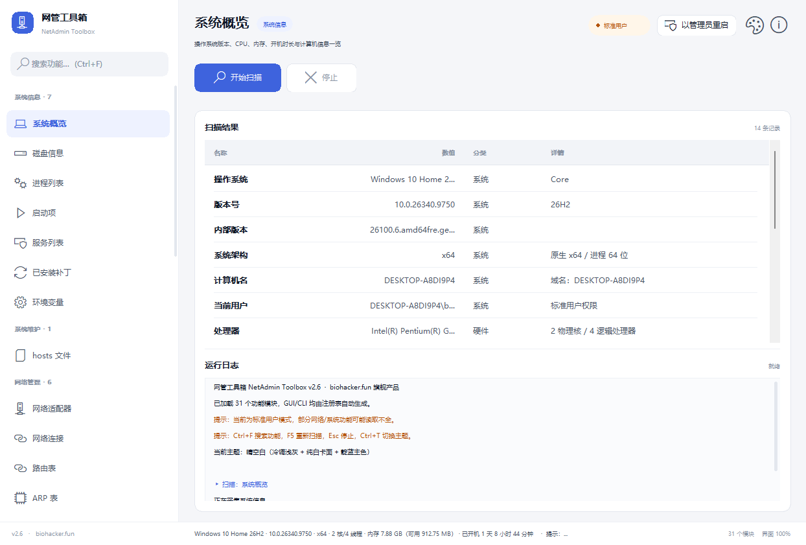

# 网管工具箱 · NetAdmin Toolbox v2.16

一个把 **系统清理 + 网络诊断 + Windows 优化 + 系统信息 + 软件管家** 整合到一起的
**单文件、免安装、可扩展** 的 Windows 网管工具集。

**biohacker.fun 旗舰产品** —— v2.16 组网助手（总 **69 个模块 / 15 分组**）：
**net.mesh** 对接自托管 Tailscale 控制服务器 headscale 的客户端接入——配置
字符串剪贴板一键导入（`NATBMESH1|服务器|预授权密钥`，容忍空白/引号、密钥
脱敏显示、DPAPI 加密落盘）；自研零依赖 QR 编码器（GF(256) + RS ECC M +
版本 1~10，GUI 弹窗位图二维码 + CLI Unicode 半块字符终端二维码）；加入
网络（检测客户端 → winget 静默安装 → `tailscale up` 非交互接入 → status
确认本机 IP）、退出网络、扫描本机与对端节点（`tailscale status --json`
解析）、检测客户端、注销并重置（danger 确认）。

v2.15 五项升级（总 68 个模块）：
**系统更新锁定**（purg.wulock：封装镜像级封锁——组策略五值 + 四服务禁用
含 WaaSMedic 自愈对抗 + 更新计划任务全禁 + 可选 hosts 域名拦截，全量备份
一键还原）；**hosts 图形化编辑**（sys.hosts 升级：多行编辑器 / 添加映射 /
屏蔽域名模板，写前自动备份 hosts.bak、只读属性自动处理）；**DNS 优化**
（net.dnsopt：9 家公共 DNS 自实现 UDP 探测测速、自动优选设主/备、
PowerShell 应用到指定网卡）；**国际化补全**（英文界面骨架全覆盖 + 查表
二分提速）；**远程终端新分组**（net.sessions 远程会话 / net.tunnel 端口
转发隧道 / net.serial 串口终端，基于 Windows 内置 OpenSSH）。

v2.14 净化中心扩展（v2.15 起净化中心共 5 模块）：**规则库生成 / YARA 扫描 /
主页锁定** + 驱动增强：对标 SoftCnKiller 的本土流氓软件查杀引擎——
进程/服务/驱动/启动项/计划任务/右键菜单(ShellEx)/输入法/文件关联/浏览器扩展/
hosts/代理 **11 类自启点全量枚举**；Authenticode 数字签名验证
（WinVerifyTrust + 证书主体提取）+ SoftCnKiller 特征库（sign.txt 396 条签名 /
folder.txt 1130 条目录特征 / whitepath.txt 白名单，编译期内嵌 base64 防杀软
内容误报，数据致谢「四海一叶秋」）；**四步判定**（白名单 → 微软签名放行 →
签名黑名单 → 目录特征）严控误报；处置先备份后动手（purg-backup.tsv 全量记录），
**「还原上次处置」一键回滚**；**特征库在线更新**（WinHTTP 双源：gitee
SoftCnKiller 数据仓库 + GitHub 本项目自有规则 extra_*.txt，行数门槛校验 +
SHA256 记录，源地址可经 rules\update.ini 自定义）。

v2.12 四项体验升级：**输入参数持久化**
（所有手工填写的路径/目标/扩展字段按模块存入配置文件，下次启动即默认值，
密码类字段 DPAPI 加密落盘）、**UAC 静默提权**（首次提权后注册计划任务通道，
后续启动不再弹 UAC）、**加域界面结构化**（域管用户名/密码、计算机名前缀
自动生成「前缀-日期-4位随机数」、工作组名独立字段）、**多语言**
（简体/繁體/English 一键切换，页头语言按钮，繁体由系统 LCMapString 转换）。

v2.11 新增**「密码工具」**分组 4 个模块
（总 55 个）：**星号密码查看器**（枚举本机可见窗口的标准 Win32 密码框，
跨进程读出掩码下的真实文本）、**ZIP 密码恢复**（传统 ZipCrypto 暴力破解：
掩码/字典双模式、多线程可中止、自实现 INFLATE 解压 + CRC32 精校零误报，
密码按 GBK 与 UTF-8 双编码各试；AES/7z/RAR 明确报不支持）、
**凭据管理器**（CredEnumerate 读取当前用户已保存凭据，Base64/UTF-16 token
智能解码，域密码按设计不展示）、**WiFi 密码查看**（netsh key=clear 读取
本机已保存无线配置文件密码，中英双语文案解析）。仅用于本机/自有资产的
密码恢复，不做任何网络服务爆破。
v2.10 完善交互：**侧栏手风琴导航**（点开一组自动收起
其它组、新增「全部展开/全部收起」按钮、组头去掉杂乱计数）、**共享部署组策略编辑**
（RestrictAnonymous / RestrictNullSessAccess / SMB 签名 / HardenedPaths 由只读升级为
「更多 ▾」中显式危险动作逐项编辑，幂等跳过已符合项 + 批量恢复默认安全基线）。
v2.9 新增**侧栏两级可展开导航**（12 组固定排序、组头点击展开/收起 + chevron、
展开态 ini 持久化、搜索强制展开）与 **4 个新模块**
（总 55 个）：**账户部署**（NetUserAdd 空密码 flags/自动登录四键/删除账户）、
**计算机名与域**（重命名校验/加域/退域回工作组，连续失败 2 次即停）、
**共享部署一键通**（14 项体检：服务/防火墙规则组 COM 权威枚举/网络配置文件/
安全键，一键开通/恢复保守）、
**共享扫描与网盘映射**（NetServerEnum+Ping 双路径主机发现、445 端口 300ms 预探测
拦截离线主机、NetShareEnum 枚举共享、WNet 一键映射/断开盘符、凭据仅会话内不落盘）。
v2.8 新增**系统管理 / 安全体检 / 常用管理**三组 11 个运维模块：
进程/服务/计划任务可视化管理（结束进程、启停服务、运行/删除任务，危险操作黑名单拦截 +
动态确认）、8 项只读体检与 9 个流式修复命令（sfc/DISM/Winsock 等，逐行日志可中止）、
系统还原点 / 本地用户 / 共享目录 / 事件日志分析 / 电源计划 / 缺失更新检查，全部操作
中文归因；启动时自动请求提权，命令行新增 `--action/--pick` 动作通道。
v2.7 新增**「软件管家」**：基于 winget 的图形化软件管理
（装机必备推荐榜单 63 款分 7 类、勾选一键安装/卸载、软件搜索、已安装管理、一键升级），
安装卸载全程隐藏窗口执行，失败只降级为文案不弹窗。v2.6 视觉体系：**靛蓝主色**的中性高级配色
（四套主题运行时切换：晴空白 / 暖阳米 / 薄雾蓝 / 深空夜）、**39px 行高的全自绘表格**
（细分隔线 + 首列加粗 + 数值右对齐 + 状态配色）、**两段式数据卡**（结果 / 日志各带
段标题与右侧状态）、品牌化侧栏（方块 Logo + 搜索框 + 自绘细滚动指示）、
**权限胶囊**替代整条横幅、**2×2 卡片式主题选择器**（内置迷你界面预览），
以及 **界面任意缩放**（Ctrl + = / Ctrl + -，85%~180% 并记忆）、PerMonitorV2 DPI 感知、
Win11 原生圆角与暗色标题栏、MDL2 Fluent 字形图标、大字号阶梯（正文 17px / 页标题 27px）。

* **交付物**：`netadmin-toolbox.exe`（约 2.3 MB，单个 exe，无任何运行时依赖）
* **架构**：模块化插件框架 —— 新增功能只需加一个 `.cpp`，界面与命令行自动出现
* **界面**：`src/ui/` 六件套 —— 设计系统 / GDI RAII / DPI / 控件库 / 主窗口 / 模态框
* **许可**：MIT（自研模块 + 开放规则集）



---

## 一、为什么是「网管工具箱」

上一版是"清理工具"，只有清理和分析两类功能。这一版按**网管日常运维**的真实需求重构：

| 场景 | 对应能力 |
| --- | --- |
| 机器慢、C 盘满 | 磁盘清理 / 空间分析 / 重复文件 / 大文件 |
| 排查网络不通 | 网络诊断（ping/DNS/TCP）、路由表、ARP 表、适配器信息 |
| 查端口占用 | 网络连接（TCP/UDP + 所属进程）、端口扫描 |
| 找局域网里的设备 | 局域网扫描（ping 扫段 + MAC + 反查主机名） |
| 看机器配置 | 系统概览、磁盘、进程、服务、启动项、补丁、环境变量 |
| 修 hosts / 清 DNS | hosts 查看+图形化编辑（备份/还原）、DNS 优化测速与优选、刷新 DNS 缓存 |
| 排障与日常运维 | 进程/服务/计划任务管理、事件日志分析、一键体检与修复、还原点/电源计划 |
| 新机开荒 | Windows 优化（40 项隐私/外观/任务栏，可还原）+ 软件管家（装机必备一键装） |

---

## 二、借鉴的开源项目

做架构和界面时参考了这些项目，取各自的长处：

| 项目 | 借鉴点 |
| --- | --- |
| [hellzerg/optimizer](https://github.com/hellzerg/optimizer) | **模块化分组**：按类别组织功能，一个功能一个独立模块，界面按组渲染 |
| [Angry IP Scanner](https://angryip.org/) | 局域网主机发现：网段探测 + 存活判断 + MAC/主机名反查 |
| [Nmap](https://nmap.org/) | 端口扫描的常见端口清单与超时策略 |
| [TrafficMonitor](https://github.com/zhongyang219/TrafficMonitor) | 网络状态的中文界面呈现方式 |
| [BleachBit](https://www.bleachbit.org/) / [Winapp2.ini](https://github.com/MoscaDotTo/Winapp2) | 规则化清理（用规则文件驱动，而不是硬编码） |
| [Czkawka](https://github.com/qarmin/czkawka) | 感知哈希做相似图片（本项目用 WIC + dHash 自研实现） |

界面层参考 Fluent Design 视觉语言（中性冷灰表面 + 靛蓝主色 + 圆角 + 分层），
用纯 Win32 owner-draw 自绘实现，**不引入任何第三方 UI 框架**。

**主题系统：四套可切换界面**

| 主题 | 风格 | 适用场景 |
| --- | --- | --- |
| **晴空白**（默认） | 冷调浅灰底 + 纯白卡面 + 靛蓝主色 | 日常明亮环境，专业清爽 |
| **暖阳米** | 米纸暖底 + 陶土棕主色 | 长时间阅读不疲劳 |
| **薄雾蓝** | 雾蓝冷底 + 钢蓝主色 | 理性技术感 |
| **深空夜** | 石墨深空暗色 + 亮靛蓝主色 | 夜间 / 低光环境 |


* 切换入口：右上角「主题」按钮（卡片式预览，点击即换）或 **Ctrl+T** 循环切换
* 选择持久化到 exe 同目录 `netadmin-toolbox-theme.ini`，重启自动恢复
* 标题栏明暗、滚动条、进度条随主题联动；全部界面元素（含对话框/Toast）即时跟随
* 实现：`design::Themes` 主题表 + `color::` inline 令牌 + `ApplyTheme` 统一刷新，
  新增一套主题只需在 `design.h` 填一组 `Palette`

---

## 三、可扩展框架（核心设计）

### 3.1 三层结构

```
┌─ 界面层 (ui/appwindow.cpp)  ─ 从注册表动态生成侧栏与页面，不含任何具体功能
├─ 命令行层 (cli.cpp)         ─ 从注册表动态分发，不含任何具体功能
└─ 模块层 (modules/*.cpp)     ─ 每个功能一个类，自己声明元信息
        ↑
   ModuleRegistry（注册表）— 唯一的耦合点
```

**关键点：GUI 和 CLI 里没有一行代码是"基础清理"或"端口扫描"。**
它们只认识 `IModule` 接口和 `ModuleRegistry`。所以新增功能完全不需要改界面。

### 3.2 新增一个功能 = 三步

1. 在 `src/modules/` 新建 `mymod.cpp`
2. 写一个类实现 `IModule`
3. 文件末尾加一行 `REGISTER_MODULE(MyClass);`

```cpp
#include "../module.h"

namespace mz {
namespace {

class MyMod : public IModule {
public:
    const wchar_t* Id() const override { return L"demo.mymod"; }   // 唯一 ID（CLI 用）
    const wchar_t* Group() const override { return L"我的工具"; }  // 侧栏分组
    const wchar_t* Title() const override { return L"示例功能"; }
    const wchar_t* Description() const override { return L"一句话说明"; }
    ModuleKind Kind() const override { return ModuleKind::Inventory; }

    // 需要输入框就打开：
    // bool NeedsPath()   const override { return true; }
    // bool NeedsTarget() const override { return true; }

    void Run(ModuleContext& ctx, ModuleResult& out) override {
        ctx.Report(0, L"正在处理…");           // 进度回调
        ctx.Log(L"这条会打到下方日志面板");     // 日志回调
        if (ctx.Cancelled()) return;           // 支持中止

        ModuleRow r;
        r.c1 = L"名称"; r.c2 = L"数值"; r.c3 = L"分类"; r.c4 = L"详情";
        out.rows.push_back(r);
        out.summary = L"完成：1 项";
    }
};

REGISTER_MODULE(MyMod);

} // namespace
} // namespace mz
```

然后 `build.bat` 会自动把 `src/modules/*.cpp` 全部编进去（脚本用通配符收集），
**不需要改构建脚本**。启动程序，侧栏「我的工具」里就会出现它，
`netadmin --list` 也会列出来。

### 3.3 模块接口速查

| 成员 | 说明 |
| --- | --- |
| `Id()` | 唯一标识，如 `net.portscan`，命令行用 |
| `Group()` | 侧栏分组名，相同分组自动归到一起 |
| `Title()` / `Description()` | 显示名与副标题 |
| `Kind()` | `Inventory` 盘点 / `Cleaner` 可清理 / `Action` 一次性动作 / `Tweaks` 开关型 / `Console` 输出型 |
| `NeedsPath()` / `NeedsTarget()` | 是否显示路径框 / 目标框 |
| `NeedsElevation()` | 是否建议管理员运行 |
| `SetInput(path, target)` | 接收界面/命令行传入的输入 |
| `PathHint()` / `TargetHint()` | 输入框的占位提示（v2.1 新增） |
| `Run(ctx, out)` | 主执行逻辑 |
| `Apply(ctx, out)` | 清理/应用逻辑（Cleaner/Tweaks 用） |
| `SetSelection(rows)` / `SupportsUndo()` / `Undo(ctx, out)` | 勾选应用与还原（v2.1 新增，Tweaks 可还原） |

`ModuleContext` 提供：`Log()` 日志、`Report(pct,msg)` 进度、`Cancelled()` 中止检查。
`ModuleResult` 返回：`rows`（表格四列）、`summary`（汇总行）、`hint`（提示）、`canClean`。

---

## 四、69 个内置模块（15 分组）

### 系统管理（5）· v2.8 + v2.9
| ID | 功能 |
| --- | --- |
| `sys.process` | 进程管理：内存降序 + 父进程反查；一键结束选中进程（csrss/lsass 等关键进程黑名单拦截并说明原因） |
| `sys.services` | 服务管理：启动/停止/暂停/继续/重启 + 启动类型切换（自动/自动延迟/手动/禁用），操作后轮询确认状态 |
| `sys.tasks` | 计划任务：任务计划程序 COM 全量枚举（含隐藏任务），立即运行/结束/启用/禁用/删除 |
| `sys.acct` | 账户部署（v2.9）：创建/更新本地账户（空密码自动加 UF_PASSWD_NOTREQD 标志）、配置/关闭自动登录（Winlogon 四键，danger）、删除指定账户；内置账户保护 |
| `sys.domain` | 计算机名与域（v2.9）：重命名计算机（DNS 主机名合法性校验）、加入域（目标框 `域名[ user:pass]`，OU 可选）、退域回工作组、查看当前状态；连续失败 2 次即停不再重试 |

### 系统信息（5）
| ID | 功能 |
| --- | --- |
| `sys.info` | 系统概览：OS 版本、CPU 型号与核心数、内存、架构、计算机名、开机时长 |
| `sys.disk` | 磁盘信息：盘符、卷标、文件系统、总/可用容量、使用率（>90% 标红） |
| `sys.startup` | 启动项：注册表 Run（HKCU/HKLM/WOW64）+ 启动文件夹 |
| `sys.hotfix` | 已安装补丁：从 CBS 包解析真实 KB 与安装时间 |
| `sys.env` | 环境变量：用户/系统作用域，REG_EXPAND_SZ 显示展开值 |

### 系统维护（1）
| ID | 功能 |
| --- | --- |
| `sys.hosts` | hosts 文件（v2.15 图形化编辑）：解析展示映射/注释；「编辑 hosts」多行编辑器全文修改、「添加映射」、「屏蔽域名模板」一键插入；写前自动备份 hosts.bak、只读属性自动处理，「还原上次修改」一键回滚 |

### 网络管理（10）· 含 v2.9 / v2.15 / v2.16 新增
| ID | 功能 |
| --- | --- |
| `net.adapters` | 网络适配器：IP/IPv6、网关、DNS、MAC、链路速率、连接状态 |
| `net.dnsopt` | DNS 优化（v2.15）：内置 9 家公共 DNS（阿里/DNSPod/114/百度/360/Google/Cloudflare/Quad9/OpenDNS）自实现 UDP 标准查询测速（3 次取最小延迟、1s 超时）；「自动优选」一键设最快两个为主/备；「应用选中」经 PowerShell Set-DnsClientServerAddress 写入指定网卡（不依赖 netsh）；「还原为自动获取」/「刷新 DNS 缓存」；同时展示当前各网卡 DNS 配置 |
| `net.conn` | 网络连接：TCP/UDP 全表 + 侦听端口 + 所属进程 |
| `net.route` | 路由表：目标网络、掩码、网关、接口、metric |
| `net.arp` | ARP 表：IP、MAC、动态/静态 |
| `net.wifi` | 无线网络：SSID、信号、认证方式、信道 |
| `net.flushdns` | 刷新 DNS 缓存（动作类） |
| `net.sharehost` | 共享部署一键通（v2.9，v2.10 增强）：14 项体检（Server/Workstation/发现四件套、防火墙「文件和打印机共享/网络发现」规则组 INetFwPolicy2 权威枚举、网络配置文件、来宾登录/匿名枚举安全键、组策略安全项 5 项、SMB1 只读）；一键开通/恢复保守/分项开关；v2.10 起「更多 ▾」含组策略安全项显式逐项编辑（放宽/恢复匿名枚举、空会话、SMB 签名降级、清除 UNC 加固、恢复默认安全基线，全部 danger 确认 + 幂等跳过已符合项） |
| `net.sharemap` | 共享扫描与网盘映射（v2.9）：NetServerEnum+Ping 双路径主机发现、445 端口 300ms 非阻塞预探测拦截离线主机、NetShareEnum 枚举共享（管理共享默认过滤）、一键映射为盘符（指定/自动分配，凭据 user:pass 仅会话内）、已映射驱动器管理与断开（含强制断开 danger） |
| `net.mesh` | 组网助手（v2.16）：对接自托管 Tailscale 控制服务器 headscale 的客户端接入。「导入配置字符串」从剪贴板解析 `NATBMESH1\|服务器\|预授权密钥`（trim 容忍空白/引号、格式头不匹配中文归因、成功回填字段，密钥脱敏显示且 DPAPI 加密持久化）；「生成接入二维码」自研零依赖 QR 编码器（byte mode + ECC M + 版本 1~10，GUI 弹窗位图绘制 / CLI 输出 Unicode 半块字符）；「加入网络」自动检测 tailscale.exe（注册表/常见路径）→ winget 静默安装 tailscale.tailscale → `tailscale up --login-server=… --authkey=… --accept-dns=false` → status 确认本机 Tailscale IP（非提权写失败如实中文归因）；「退出网络」tailscale down；「扫描网络状态」解析 `tailscale status --json` 展示本机与全部对端节点（主机名/IP/在线状态/版本）；「检测客户端」独立检查安装与版本；「注销并重置」danger 确认后 `tailscale logout` |

### 网络诊断（3）
| ID | 功能 |
| --- | --- |
| `net.diag` | 网络诊断：ping（4 次统计）、DNS 解析、TCP 连通性 → 填目标框 |
| `net.portscan` | 端口扫描：常见 20+ 端口，非阻塞 connect + 超时 → 填目标框 |
| `net.lanscan` | 局域网扫描：自动推算 /24 网段，ping 扫段 + MAC + 主机名 |

### 安全体检（2）· v2.8
| ID | 功能 |
| --- | --- |
| `sec.scan` | 一键体检（8 项只读）：UAC / Defender 实时保护 / 防火墙三配置文件 / 系统盘空间 / 更新滞后 / sfc 完整性（CBS.log）/ 关键服务 / 系统还原服务，警告项红标并给修复指引 |
| `sec.repair` | 系统修复（9 个动作）：sfc / DISM RestoreHealth / chkdsk 只读 / Winsock 重置 / 网络栈重置 / Defender 快速扫描与更新 / DISM ScanHealth / chkdsk 预约，全部经流式执行器逐行输出、可随时中止 |

### 净化中心（5）· v2.13 / v2.14 / v2.15
| ID | 功能 |
| --- | --- |
| ID | 功能 |
| --- | --- |
| `purg.wulock` | 系统更新锁定（v2.15）：扫描封锁状态（组策略 WindowsUpdate/AU 全值、服务 wuauserv/UsoSvc/WaaSMedicSvc/DoSvc 经 SCM API、更新计划任务两目录、hosts 拦截块）；「锁定系统更新」= 封装镜像级封锁（NoAutoUpdate/DisableWindowsUpdateAccess 等 5 策略值 + 服务禁用含 WaaSMedic 注册表直写与 FailureActions 自愈修补 + 计划任务全禁 + 可选 hosts 更新域名拦截块）；全量原值备份 wulock-backup.tsv，「还原更新锁定」一键回滚；非提权写失败如实计数并中文归因；主页锁定手法由 purg.homepage 覆盖（见 docs/dev-notes-wulock.md） |
| `purg.scan` | 全盘查杀：13 类检测点全量枚举（进程/服务/驱动/内核模块/隐藏进程/启动项/计划任务/右键菜单 ShellEx/输入法/文件关联/浏览器扩展/hosts/代理，后两类为 v2.14 驱动增强）；Authenticode 签名验证（WinVerifyTrust + 证书主体 O/CN 提取，进程内缓存）+ SoftCnKiller 特征库匹配（396 签名 + 1130 目录特征 + 白名单，内嵌 base64 防杀软误报，致谢「四海一叶秋」）；四步判定（白名单 → 微软签名放行 → 签名黑名单 → 目录特征）；处置先备份（purg-backup.tsv）后动手（结束进程/禁用服务·驱动/删启动项/删任务/移除 ShellEx 注册/删输入法布局/恢复关联/隔离扩展/清 hosts 劫持行/关代理），「还原上次处置」倒序一键回滚；特征库在线更新（gitee SoftCnKiller + GitHub 自有 extra_* 规则双源，行数门槛校验 + SHA256 记录，rules\update.ini 可配置源）；非提权正确拒绝并归因 |
| `purg.rules` | 规则库生成（v2.14）：可视化维护自定义规则——签名（按签名主体命中）/ 目录（路径片段命中）/ 白名单（路径片段放行）三类，写入 rules\custom_*.txt（与在线更新 extra_* 分离防覆盖），支持添加/删除/去重/最短长度防误报校验/导出规则包（purg-rules-export.txt，可直接上传 GitHub 自有规则源） |
| `purg.yara` | YARA 扫描（v2.14）：零依赖自研 YARA 子集引擎——文本串（ascii/wide/nocase/fullword）、十六进制串（?? 通配、[n]/[n-m]/[n-] 跳转）、条件（$a at N / and/or/not / any·all·N of them·of ($a,$b*) / filesize 比较含 KB/MB）；规则放 rules\yara\*.yar（首运自动落内置示例规则），扫描文件或目录（单文件 ≤32MB、单次 ≤2 万文件），命中列表展示规则/串/偏移；超出子集的规则明确跳过并记日志 |
| `purg.homepage` | 主页锁定（v2.14）：扫描 IE 主页与搜索引擎劫持、Edge/Chrome 策略劫持（Homepage/RestoreOnStartupURLs）、桌面快捷方式 URL 参数劫持；一键修复并设置目标主页（修改前 TSV 备份，可一键还原）；策略级锁定/解锁主页（防再次篡改）；微软默认主页降噪不列报 |
| 驱动增强（并入 `purg.scan`） | v2.14：①已加载内核模块枚举（NtQuerySystemInformation(SystemModuleInformation)，覆盖服务注册表被隐藏/ImagePath 被清的驱动，与服务枚举去重合并，无同名服务键额外标注）②隐藏进程检测（NT 进程链表 ∪ 扩展句柄表 vs Toolhelp32 快照差集，抓 DKOM 摘链类 rootkit）；处置=禁用驱动服务/结束隐藏进程，先备份可还原 |

### 密码工具（4）· v2.11
| ID | 功能 |
| --- | --- |
| `pwd.reveal` | 星号密码查看器（v2.11）：枚举可见窗口中的标准 Win32 密码框（Edit/RichEdit + ES_PASSWORD），WM_GETTEXT 跨进程读出真实文本；自绘界面（浏览器等）按设计不支持 |
| `pwd.zip` | ZIP 密码恢复（v2.11）：传统 ZipCrypto 暴力破解，掩码（d/l/u/a/A/自定义字符集 + 长度区间）与字典（dict:路径）双模式，多线程可中止；命中判定 = 12 字节校验粗筛 + 全量解密 + 自实现 INFLATE + CRC32 精校；GBK/UTF-8 双编码 |
| `pwd.cred` | 凭据管理器（v2.11）：CredEnumerate 枚举当前用户凭据，GENERIC blob 按 UTF-16/UTF-8 智能解码出密码，Base64 token 原样展示；域密码受系统保护不展示 |
| `pwd.wifi` | WiFi 密码查看（v2.11）：netsh wlan show profile key=clear 读取本机已保存网络密码，中英系统双语文案解析，开放式网络正确识别 |

### 远程终端（3）· v2.15 新分组
| ID | 功能 |
| --- | --- |
| `net.sessions` | 远程会话：SSH/SFTP/Telnet 会话档案管理（exe 同目录 netadmin-sessions.ini 持久化，字段：名称/协议/主机/端口）；「连接选中」调用 Windows 内置 OpenSSH（ssh.exe / sftp.exe）以 CREATE_NEW_CONSOLE 新控制台启动；不存密码（连接时交互输入，推荐公钥免密）；Telnet 缺失提示启用系统功能；OpenSSH 缺失时「安装 OpenSSH 客户端」一键安装 |
| `net.tunnel` | 端口转发隧道：-L 本地 / -R 远程 / -D 动态 SOCKS 三型，生成 ssh -N 命令（跳板 user@host[:端口]，ServerAliveInterval 保活）并启动（记录 PROCESS_INFORMATION 句柄）；启动/停止/停止全部；定义持久化（netadmin-tunnels.ini）；活动状态实时展示（进程退出如实显示未运行） |
| `net.serial` | 串口终端：QueryDosDevice 枚举 COM 口；DCB 配置（波特率/数据位/停止位，无校验）；「打开串口监视」实时显示接收数据（Esc 停止）、「发送并读取响应」3 秒收发；图形化交互终端（方向键/历史回看）暂不支持 |

### 常用管理（6）· v2.8
| ID | 功能 |
| --- | --- |
| `sys.restore` | 系统还原点：一键创建（描述可自定义），「系统还原被禁用 / 24 小时频率限制」失败自动归因 |
| `sys.users` | 本地用户：枚举（权限/状态/密码策略/最后登录），一键启用/禁用；Administrator/Guest/DefaultAccount 内置账户受保护 |
| `sys.shares` | 共享目录：枚举（类型/路径/连接数）与取消共享；IPC$ / ADMIN$ / X$ 管理共享只读保护 |
| `sys.events` | 事件日志分析：近 7 天 System/Application 错误与严重事件按「来源 + 事件 ID」聚合 Top 20 |
| `sys.power` | 电源计划：枚举（当前使用排前）一键切换 + 复制启用隐藏的「卓越性能」模式 |
| `sys.update` | 缺失更新检查：Windows Update 检索缺失更新与体积（只查不装） |

### 磁盘清理（5）
| ID | 功能 |
| --- | --- |
| `clean.basic` | 基础清理：临时文件、浏览器缓存、回收站、应用缓存等 17 项 |
| `clean.system` | 系统清理：日志、更新缓存、WinSxS、休眠/虚拟内存等 12 项 |
| `clean.wechat` | 微信清理（3.x / 4.x） |
| `clean.qq` | QQ / NTQQ 清理 |
| `clean.appcache` | 应用缓存（Winapp2 规则引擎） |

### 空间分析（6）
`scan.large` 大文件 · `scan.dup` 重复文件（三级哈希）· `scan.similar` 相似文件 ·
`scan.similarimg` 相似图片（dHash 感知哈希）· `scan.dirs` 目录大小 · `scan.apps` 软件占用

### 高级工具（2）
`tool.move` 软件搬家（Junction，可回滚）· `tool.usermigrate` 用户目录迁移

### 系统优化（1）
`tweak.winopt` Windows 优化（40 项，可还原）

### 软件管家（11）
| ID | 功能 |
| --- | --- |
| `soft.rec` | 装机必备 · 推荐总榜：63 款免费好软件，显示已装/未装与版本，未安装排在前 |
| `soft.rec.browser` | 浏览器上网：Chrome / Firefox / Edge / Vivaldi / Opera |
| `soft.rec.file` | 压缩与文件管理：7-Zip / Everything / WizTree / WinMerge / WinSCP / Ventoy 等 |
| `soft.rec.office` | 办公与效率：WPS / LibreOffice / SumatraPDF / Notepad++ / Obsidian / PowerToys / 密码库等 |
| `soft.rec.dev` | 开发与运维：Git / VS Code / Python / Node.js / Docker / PowerShell / Postman |
| `soft.rec.media` | 影音与图像：VLC / OBS / ShareX / GIMP / Inkscape / IrfanView / PotPlayer |
| `soft.rec.chat` | 通讯与社交：微信 / QQ / 钉钉 / 飞书 / 企业微信 / Telegram / Zoom / 腾讯会议 |
| `soft.rec.sys` | 系统与安全：CPU-Z / CrystalDiskInfo / VeraCrypt / Malwarebytes / ToDesk |
| `soft.search` | 软件搜索：winget 全网搜索（目标框输关键词），勾选一键安装/卸载 |
| `soft.installed` | 已安装软件：winget list 全量清单，勾选卸载（MSIX/ARP 原样展示） |
| `soft.upgrade` | 软件升级：winget upgrade 可升级列表，勾选一键更新 |

* 依赖系统 winget（Windows 包管理器，随「应用安装程序」分发）；未检测到时模块给出
  安装引导，不弹窗、不崩溃
* 「安装选中」支持全家桶模式：不勾选直接点 = 安装本榜全部未安装软件（自动跳过已装）
* 安装/卸载/升级均隐藏窗口执行并捕获输出，失败项在日志与汇总中列明，支持 Esc 中止

---

## 五、使用

### 5.1 图形界面

双击 `netadmin-toolbox.exe`（无参数即 GUI）。

* 左侧按分组列出全部模块，选中即进入
* 需要输入的功能会自动出现输入框（路径 / 目标 IP）
* 底部日志实时输出过程
* 右上角「以管理员重启」可提权（部分网络/系统功能需要）

**v2.6 界面特性：**

| 操作 | 效果 |
| --- | --- |
| `Ctrl+F` / 侧栏搜索框 | 实时过滤模块（匹配标题/描述/ID，含中文） |
| `F5` | 重新执行当前模块扫描 |
| `Esc` | 停止正在运行的任务；模态对话框中按下可直接关闭 |
| `Ctrl+T` / 「主题」按钮 | 切换四套界面主题（2×2 卡片预览点击即换，选择自动保存） |
| **`Ctrl + =` / `Ctrl + -` / `Ctrl + 0`** | **界面整体放大 / 缩小 / 复位（85%~180%，窗口同步增长，选择自动记忆）** |
| 点击表头「名称/数值」 | 结果排序（再次点击切换升降序；勾选型模块锁定行序防误操作） |
| 「全选 / 取消全选」 | Tweaks 模块批量选中 |
| 「还原选中」 | 对选中的优化项执行还原（只对支持还原的项生效） |
| 主操作按钮 | MDL2 Fluent 字形图标 + 文字（扫描/应用/还原/停止/全选），随状态动态切换 |
| 模态对话框 | 标题栏 ✕、取消按钮、Esc 三种关闭方式全部可用 |
| 右上角「关于」 | DNA 图标 + 版本信息 + 访问官网 |
| 操作完成 | 右下角 Toast 轻提示（淡入淡出，贴在状态栏上方，不遮挡内容） |
| 数据面板 | 「扫描结果 + 运行日志」收进一张圆角卡片，段标题 34px + 右侧状态（条数 / 运行中提示） |
| 结果表格 | 全自绘：39px 行高、行分隔线内缩 14px、首列加粗、数值列右对齐、选中/危险行整行着色、空状态带圆底图标 |
| 日志面板 | 自绘控制台 + 细滚动条：拖动时整窗高质量重绘，文字始终清晰；上翻历史时新日志不抢视角 |
| 字号 | 大字阶梯：页面标题 27 / 区块标题 19 / 正文按钮导航 17 / 辅助 14 / 页脚 13 / 日志 16；还嫌小就 Ctrl + = 再放大 |


### 5.2 命令行

```bat
netadmin-toolbox.exe                         启动图形界面
netadmin-toolbox.exe --list                  列出全部模块
netadmin-toolbox.exe --help                  帮助

:: 按模块 ID 执行
netadmin-toolbox.exe run sys.info
netadmin-toolbox.exe run net.adapters
netadmin-toolbox.exe run net.conn
netadmin-toolbox.exe run clean.basic

:: 带输入参数
netadmin-toolbox.exe run net.diag     --target 8.8.8.8
netadmin-toolbox.exe run net.portscan --target 192.168.1.1
netadmin-toolbox.exe run scan.large   --path D:\ --target 500

:: 软件管家（winget）
netadmin-toolbox.exe run soft.rec                          :: 装机必备推荐总榜
netadmin-toolbox.exe run soft.search --target python       :: 搜索软件
netadmin-toolbox.exe run soft.installed                    :: 已安装软件
netadmin-toolbox.exe run soft.upgrade                      :: 可升级软件

:: 扩展动作通道（v2.8）：--action N 选第 N 个动作（0 起），
:: --pick 名称或PID 选中目标行（数字按 PID/索引精确匹配），省略则作用于全部行
netadmin-toolbox.exe run sys.process --action 0 --pick notepad.exe    :: 结束指定进程
netadmin-toolbox.exe run sys.users   --action 0 --pick 某用户名       :: 启用账户
netadmin-toolbox.exe run sys.tasks   --action 2 --pick 任务名        :: 启用计划任务
netadmin-toolbox.exe run sec.repair  --action 2                       :: chkdsk 只读检查

:: 加域结构化字段（v2.13）
netadmin-toolbox.exe run sys.domain --action 1 --target corp.local --field 0=CORP\\admin --field 1=密码

:: 密码工具（v2.11）
netadmin-toolbox.exe run pwd.zip --path D://docs//backup.zip --target d:4-8   :: 数字 4-8 位掩码破解
netadmin-toolbox.exe run pwd.zip --path D://docs//backup.zip --target dict:D://dicts//common.txt
netadmin-toolbox.exe run pwd.reveal                                          :: 扫描本机密码框
netadmin-toolbox.exe run pwd.cred                                            :: 读取已存凭据
netadmin-toolbox.exe run pwd.wifi                                            :: 读取已存 WiFi 密码

:: v2.9 新模块
netadmin-toolbox.exe run sys.acct    --action 0 --target 新用户名     :: 创建/更新账户（--path 填「描述|密码」，留空=无密码）
netadmin-toolbox.exe run sys.domain                                   :: 计算机名/工作组/域状态
netadmin-toolbox.exe run net.sharehost                                :: 共享环境 14 项体检
netadmin-toolbox.exe run net.sharehost --action 9                     :: 仅刷新（唯一非提权放行动作）
netadmin-toolbox.exe run net.sharemap                                 :: 扫描局域网共享（目标框可填盘符）
netadmin-toolbox.exe run net.sharemap --action 1 --pick Z:            :: 断开指定映射

:: v2.16 新模块
netadmin-toolbox.exe run net.mesh                                     :: 组网助手：扫描 Tailscale 网络状态
netadmin-toolbox.exe run net.mesh --action 2                          :: 从剪贴板导入配置字符串
netadmin-toolbox.exe run net.mesh --action 3                          :: 终端输出接入二维码（半块字符）
netadmin-toolbox.exe run net.mesh --action 4                          :: 检测 Tailscale 客户端
netadmin-toolbox.exe run net.mesh --action 0                          :: 加入网络（装客户端/接入/status 确认）

:: v2.15 新模块
netadmin-toolbox.exe run purg.wulock                                  :: 更新封锁状态扫描（锁定/还原经 --action 0/1）
netadmin-toolbox.exe run net.dnsopt                                   :: 公共 DNS 测速（--action 0 自动优选）
netadmin-toolbox.exe run sys.hosts                                    :: hosts 解析展示（编辑动作在 GUI）
netadmin-toolbox.exe run net.sessions                                 :: 远程会话列表（连接经 --action 0）
netadmin-toolbox.exe run net.tunnel                                   :: 隧道定义列表（启动/停止经 --action 0/1）
netadmin-toolbox.exe run net.serial                                   :: COM 口枚举
```

退出码：`0` 成功，`1` 参数/模块错误。

### 5.3 Winapp2 规则

程序内置 41 个应用节的精选规则。如需社区全量规则（数千条），
把 [Winapp2.ini](https://github.com/MoscaDotTo/Winapp2) 放到 **exe 同目录**，
程序会优先加载，并自动套用危险路径过滤。

---

## 六、构建

```bat
build.bat          增量构建
build.bat clean    清理后全量构建
```

依赖：**MinGW-w64 g++ ≥ 12**（当前 16.2.0 验证）。`build.bat` 里 `MINGW` 变量指向编译器。
除此之外只用 Windows SDK，无任何第三方库。

### 源码结构

```
src/
  main.cpp          入口：有参数→CLI，无参数→GUI
  module.h/.cpp     ★ 可扩展模块框架（接口 + 注册表）
  cli.cpp           ★ 命令行（由注册表动态分发）
  common.h/.cpp     UTF-8/大小格式化/提权/隐藏执行
  procrun.h/.cpp    流式进程执行器：长任务逐行日志/可中止/超时终止（v2.8）
  cleanresult.h/.cpp 清理结果模型 + Win32/HRESULT 错误码中文归因
  cleaner.h/.cpp    磁盘清理与分析引擎
  winapp2.h/.cpp    Winapp2 规则引擎
  simhash.h/.cpp    图像 dHash 感知哈希
  regengine.h/.cpp  .reg 解析器 + 注册表读写
  debloat.h/.cpp    Windows 优化特性
  qr.h/.cpp         ★ 零依赖 QR 编码器：byte mode + ECC M + v1~v10、
                    GF(256)/RS/8 掩码 penalty、终端半块字符输出（v2.16）
  ui/               ★ v2.6 界面层（多主题 + 可缩放 + 卡片化 + 全自绘）
    design.h/.cpp     设计系统：主题表/Palette/inline 令牌/切换/持久化
    dpi.h/.cpp        PerMonitorV2 DPI 感知与缩放
    gdi.h/.cpp        GDI RAII 封装（Pen/Brush/Font/双缓冲）+ 绘制助手
    controls.h/.cpp   控件库：Fluent 按钮/搜索框/Toast 通知
    appwindow.h/.cpp  主窗口：布局/导航/排序/自绘/工作线程消息循环
    dialog.h/.cpp     模态对话框：确认框 + 关于框 + 主题选择器
  modules/
    cleanmods.cpp   14 个清理/分析/优化模块
    netmods.cpp      9 个网络模块
    netmods2.cpp     DNS 优化：公共 DNS UDP 测速/自动优选/PowerShell 应用（v2.15）
    netmesh.cpp      组网助手：headscale/Tailscale 接入 + 剪贴板导入 + QR 弹窗（v2.16）
    remote.cpp       远程终端三模块：远程会话/端口转发隧道/串口终端（v2.15）
    sysmods.cpp      8 个系统模块（含 v2.8 进程/服务管理、v2.15 hosts 编辑）
    softmods.cpp    11 个软件管家模块（winget）
    taskmods.cpp     计划任务管理（任务计划程序 COM，v2.8）
    secmods.cpp      安全体检与修复（v2.8）
    pwdmods.cpp      密码工具四模块：星号密码查看器/ZIP 密码恢复/凭据管理器/WiFi 密码查看（v2.11）
    mgmtmods.cpp     常用管理六模块：还原点/用户/共享/事件/电源/更新（v2.8）
    acctmods.cpp     账户部署 + 计算机名与域（NetUser/Winlogon/加退域，v2.9）
    sharehost.cpp    共享部署一键通（SCM/防火墙 COM/安全键，🔴 项只读，v2.9）
    sharemap.cpp     共享扫描与网盘映射（Ping/445 预探测/NetShareEnum/WNet，v2.9）
    purgmods.cpp     净化中心：全盘查杀（11 类自启点/签名验证/四步判定，v2.13）
    purgmods2.cpp    净化中心：规则库生成/YARA 扫描/主页锁定（v2.14）
    purgmods3.cpp    净化中心：系统更新锁定（策略/服务/计划任务/hosts，v2.15）
  app.rc / app.manifest   资源（图标/版本）+ DPI 感知清单
data/
  Winapp2.ini       内置精选规则集
  winapp2_builtin.h 规则集内嵌
  features.tsv      40 项优化元数据
  regfiles.h        80 个 .reg 内嵌
tools/              图标生成 / GUI 冒烟与验证脚本（见下）
```

★ = 框架核心，扩展功能时通常**不需要改动**。

### 6.1 界面层设计要点（v2.6）

* **零全局状态**：所有句柄/线程/字体由 `AppWindow` 类 RAII 管理
* **双缓冲渲染**：`DoubleBuffer` 内存 DC 位块传送，彻底消除闪烁
* **DPI 感知 + 界面缩放**：动态加载 `SetProcessDpiAwarenessContext(PerMonitorV2)`，
  跨显示器移动不模糊；`S(px)` = `px × DPI/96 × 用户倍率` 是唯一的尺寸入口，
  因此按 Ctrl + = 时**字体、间距、圆角、控件高度全部等比放大**，调用点零改动
* **Win11 集成**：`DwmSetWindowAttribute` 沉浸式暗色标题栏 + 圆角窗口，
  `uxtheme` 暗色滚动条（均随主题明暗联动）
* **线程模型**：工作线程只读输入快照，完成后 `PostMessage(WM_APP+n)` 回传 UI 线程
* **子类化自绘**：导航悬停、表头排序指示、Tweaks 勾选保护
* **主题系统**：`Theme`/`Palette` 结构 + `color::` inline 令牌，`ApplyTheme`
  统一刷新（令牌/画刷/chrome/持久化/回调）；调用点零改动
* **卡片式数据面板**：结果与日志收进一张圆角卡片，各带 34px 段标题与右侧状态；
  列表高度按「实测表头高度 + 整数行」取整，窗口再怎么拉都不会把最后一行拦腰截断
* **全自绘表格**：`CDDS_ITEMPREPAINT` 返回 `CDRF_SKIPDEFAULT`，行底色/分隔线/字重/
  列对齐全部自绘；选中态用 `ListView_GetItemState(LVIS_SELECTED)` 真实查询
  （owner-draw 下 `uItemState & CDIS_SELECTED` 在部分系统上对每行都为真，会把整表刷成选中色）
* **表头高度**：系统按字体行高决定表头高度且每次 `WM_SIZE` 都会重置，
  因此给表头单独下发一只「高行高字体」把表头撑到 39px（标签本身仍走自绘），
  再按实测高度做整行取整
* **图标系统**：按钮 MDL2 字形（Segoe MDL2 Assets）34px 图标槽，随模块状态动态切换
* **模态闭环**：`ModalPage::OnCommand` 返回 true 即关闭；子按钮显式 `WS_VISIBLE`
  + 键盘子类化（Enter/Space/Esc/Tab），彻底消除「点了卡住、取消无反应」。
  按钮摆放用 `GWL_STYLE & WS_VISIBLE` 判断而非 `IsWindowVisible`
  ——后者在父窗口尚未显示时返回 FALSE，会让按钮永远停在 (0,0)
* **日志控制台**：自绘 `LogView`（行缓冲 + 垂直滚动 + 双缓冲），
  替换系统 EDIT——EDIT 滚动时 Windows 强制 ClearType 灰度降级 + 局部重绘，
  文字发虚拖影且应用层无法关闭；自绘后每次滚动都是整窗高质量重绘。
  智能跟随：用户上翻看历史时新日志不抢视角，回到底部自动恢复跟随
* **字号阶梯**：27/19/17/14/13/16 六级，96 DPI 基准，相邻层级差 ≥2px；
  正文 17px ≈ 印刷四号，是长时间盯屏的舒适点（14~15px 笔画偏细，正是「字小」的主因）

### 6.2 GUI 自动化验证（tools/）

| 脚本 | 用途 |
| --- | --- |
| `gui_smoketest.ps1` | 端到端冒烟：启动→切模块→扫描→搜索→关于→退出 |
| `gui_verify3.ps1` | 列排序验证：真实鼠标点击表头，远程内存读首行文本比对 |
| `gui_verify_dialog.ps1` | 对话框专项：取消按钮/Esc/✕ 三条关闭路径逐一实测 |
| `gui_shot_tweaks.ps1` | Tweaks 模块截图：40 项数据 + 全量按钮字形渲染 |
| `gui_verify_theme.ps1` | 主题切换：逐张点击 4 张主题卡片 + 像素级校验背景色 + 重启持久化 |
| `gui_verify_font.ps1` | 字重/日志专项：大字主界面截图 + 41 行日志滚动条拖动定位 + 暗色主题日志跟随 |
| `gui_verify_scale.ps1` | 界面缩放：keybd_event 注入 Ctrl+= / Ctrl+0，校验窗口同比放大与 ini 记忆 |
| `gui_shot_ui.ps1` | 视觉快照：数据面板 / 关于框 / 确认框 / 120% 缩放四张实拍 |
| `gui_shot_v26.ps1` | v2.6 视觉快照六张（空状态 / 数据表 / 主题选择器 / 关于 / 优化列表 / 确认框），`PrintWindow` 直接取客户区，不受遮挡影响 |
| `t01_nav_test.ps1` | v2.9 侧栏两级导航 18 项断言：固定组序/收起展开/ini 持久化/搜索强制展开/缩放同步/四主题/键盘滚轮 |
| `t02_acct_domain_test.ps1` | v2.9 sys.acct/sys.domain GUI：页面渲染/danger 确认框/更多菜单/非提权拒绝/回归抽查 |
| `t03_sharehost_test.ps1` | v2.9 net.sharehost GUI：14 项体检渲染/一键开通与恢复保守 danger 确认框/更多菜单/拒绝路径/仅刷新放行 |
| `t04_sharemap_test.ps1` | v2.9 net.sharemap GUI：已映射区/真实断开闭环/更多菜单/fForce danger 确认框 |
| `t04_regression.ps1` | v2.9 回归套件：T01 导航核心（67 行基线）+ T02/T03 CLI 抽查 + 拒绝输出干净性断言 |

---

## 七、验证结果

| 项目 | 结果 |
| --- | --- |
| 模块注册 | **69 个模块**，15 个分组（含净化中心 5 模块、远程终端 3 模块），侧栏/CLI 自动生成 |
| CLI 分发 | `--list` 与 `run <id>` 全部可用，输出对齐正确 |
| 系统信息 | 实测 Windows 10 Home 26H2 / 10.0.26340.9750 / 2C4T / 7.88 GB / 3 盘 1153.82 GB |
| 网络模块 | 实测 2 个适配器（192.168.1.55 / 网关 / MAC / DNS / 1Gbps）、TCP 392 条（侦听 49）/ UDP 69 条 / 42 进程 |
| 清理模块 | 基础清理 17 项、系统清理 12 项，可清理/仅统计分开统计 |
| 感知哈希 | 同画面不同尺寸/格式正确聚组（距离 0~4），不同图分开（29） |
| 规则引擎 | Winapp2 解析与独立 Python 参考实现**逐条等价**（80/80 文件、326/326 操作） |
| winget 软件管家 | 榜单 63 款全部 `winget show --id` 实测可解析；`soft.search --target notepad` 实测命中 Notepad++.Notepad++（45 个结果）；总榜正确标记本机已装 6 款（7zip/Git/Chrome/Edge/WindowsTerminal/企业微信）并带版本；表格解析对中文行（Windows 终端/豆包）列对齐正确；install/uninstall/upgrade 命令串实测被 winget 接受 |
| 系统管理/安全体检/常用管理（v2.8） | sys.users 实测 5 账户（内置账户红标、权限/最后登录正确）；sys.shares 实测 5 个管理共享类型识别正确；sys.events 近 7 天 89 条聚合 12 类、排序正确；sys.power 3 方案枚举 + 活动方案高亮；sys.restore 非提权正确拒绝并归因；sys.process 结束进程实测生效、关键进程拒绝；sys.tasks 85 个任务枚举 + 立即运行实证；sec.scan 8 项体检约 0.9s 全部给出结论 |
| 侧栏两级导航（v2.9） | 12 组固定排序、组头点击收起/展开（67 行基线 ↔ 62 行）、chevron 方向正确、展开态 ini 持久化重启保持、收起态搜索强制展开/清空恢复折叠记忆、键盘方向键+回车切组、四主题走查（18 项断言全过） |
| 账户部署与域（v2.9） | sys.acct/sys.domain CLI 非提权中文拒绝路径实测；danger 确认框（自动登录明文风险/名称校验拒绝）弹出演示；提权真实路径（建户/改名/加退域）留管理员机补测 |
| 共享部署（v2.9） | net.sharehost 14 项体检全出（2 就绪/6 待处理/6 仅展示），与 Get-Service、Get-NetFirewallRule 权威对账一致（防火墙组 0/43、26/58 精确吻合）；INetFwPolicy2 COM 探测命中；🔴 安全敏感项代码层无写路径；一键开通/恢复保守 danger 确认框（动态🟡变更列）弹出演示 |
| 共享扫描与映射（v2.9） | net.sharemap 扫描 11 台存活（与 net.lanscan 对齐，3.7s）；NetServerEnum 浏览器超时 19.7s 已用后台线程+1s 预算根治；445 预探测拦截离线主机；映射最小闭环全真（\\127.0.0.1\C$ → Z: → 模块动作真断开，WNet 枚举复查为空）；「断开全部」fForce 动态清单 danger 确认框弹出演示 |
| GUI 冒烟 | 启动/切模块/扫描（磁盘 3 盘）/搜索过滤（39→11→39）/关于对话框/Esc 关闭/干净退出 |
| 密码工具（v2.11） | pwd.zip 10 用例全过：掩码/字典/7-Zip 真实 zip 三路命中（12 字节粗筛+INFLATE+CRC 精校零误报）、未加密/假 zip/仅检测/参数错误/空间不足/文件不存在正确归因；INFLATE 独立压测 27/27（3 种数据 × zlib 9 级）；pwd.cred 实测 2 条凭据（Base64 token 解码、域密码保护）；pwd.reveal 枚举 8 窗口无异常；pwd.wifi 无网卡环境优雅降级；GUI 侧栏「密码工具」组 4 项断言 PASS |
| v2.13 四项升级 | GUI 25 断言全过：扩展字段 4 行渲染/输入持久化回填（OU/域名/用户名/前缀/工作组）/密码 DPAPI 密文落盘且 ini 无明文/重启解密回填/密码框跨进程保护；语言三循环（zh-CN→zh-TW→en-US→zh-CN）按钮文案与 ini 持久化断言；CLI --list 59 模块、clean.basic 17 项 433MB、sys.domain --field 解析与提权拒绝路径正常 |
| 净化中心二期（v2.14） | GUI t214 全过：侧栏三新模块（规则库生成/YARA 扫描/主页锁定）切换与按钮组（刷新规则列表/添加规则/删除选中规则、开始扫描/打开规则目录、扫描劫持/修复并设置主页/还原上次修改）、主页扫描截图核验；CLI --list 63 模块；YARA 实测 hex 规则（MZ@0+UPX!@64）与文本规则（3 串命中）、干净文件 0 误报；purg.rules 添加/去重/列表/导出全通且自定义签名规则（Google LLC）端到端生效（全盘查杀 20 处命中）；purg.homepage 微软默认主页降噪后本机 0 劫持、策略锁写失败如实报错（CLI 永不提权语义）；Defender Trojan:Win32/Kepavll!rfn 二次误报经 UAC 排除目录解决（发布版需代码签名） |
| v2.15 五项升级 | CLI --list 68 模块 15 组；purg.wulock 扫描实测（策略/服务/任务/hosts 四类状态全出，非提权锁定动作如实报拒绝并中文归因）；net.dnsopt 测速实测（14 个公共 DNS 全部给出延迟并按最快排序，当前网卡 DNS 展示正确）；net.sessions/net.tunnel/net.serial 列表与 OpenSSH 检测实测；sys.hosts 编辑动作（备份/还原/模板）代码审查 + 只读解析回归通过；英文界面切换抽验（模块标题/动作按钮/字段标签全英，未登记运行日志按设计回退中文）；kEn 表改二分查找（300+ 条目 O(log n)） |
| v2.16 组网助手 | QR 编码器 5 用例 zxing-cpp 解码全 PASS（37B v3 / 75B v5 / 208B v10 五块交织 / 213B 精确容量边界均解码比对一致，214B 超容正确拒绝）；CLI 终端二维码文本重建矩阵与编码器矩阵逐格一致（mismatch 0）且端到端 zxing 解码 payload 逐字符一致；CLI 导入 4 条错误路径（缺分隔符/格式头不符/4 段/URL 无协议头）中文归因 + 合法导入（引号+空白+CRLF 容错、密钥脱敏）字段回填成功；本机未装 Tailscale 时扫描/检测客户端/加入网络正确给出未安装提示与 winget 引导行；CLI --list 69 模块 15 组、--help v2.16；GUI 冒烟启动无崩溃 |
| 净化中心 M1（v2.13） | GUI t213 全过：侧栏「净化中心/全盘查杀」、按钮组（开始查杀/处置选中项/还原上次处置/更多 ▾）、真实点击扫描完成、截图核验；CLI --list 60 模块 14 组；实测四步判定——微软签名 0 误报（111 进程/279 服务/198 驱动）、签名命中通道（extra_sign.txt 写 Google LLC → Chrome 19 处命中）、白名单通道（extra_white.txt 命中即放行）、目录通道（\temp\ 命中）；在线更新实测 gitee 三文件下载+校验+SHA256 落盘（自有源 404 优雅跳过）；驱动 ImagePath \SystemRoot\ 前缀修复；Defender PUA:Win32/Softcnapp 特征库内容误报经 base64 内嵌规避 |
| GUI 排序 | 真实鼠标点击表头：默认序→升序→降序三种首行互不相同（WorkBuddy.exe→AggregatorHost.exe→[System Process]） |
| 对话框修复 | 取消按钮 BM_CLICK / Esc 键 / 标题栏 ✕ 三条关闭路径全部实测通过（**[ALL OK]**） |
| 按钮字形 | Tweaks 模块 6 个 MDL2 图标按钮渲染截图确认，无豆腐块 |
| 主题切换 | 4 张主题卡片逐一点击切换，背景像素校验全对（245,246,249 / 246,241,231 / 237,241,247 / 10,12,17），模态均正常关闭 |
| 主题持久化 | 切换后重启自动恢复上次选择（ini 读写实测） |
| 界面缩放 | Ctrl + = 逐档放大（110/120/135%），窗口同比放大 1260×880 → 1512×994；Ctrl + 0 复位；倍率写入 ini 并重启恢复 |
| 视觉快照 | v2.6 六张实拍（空状态 / 数据表 / 主题选择器 780×560 / 关于 640×400 / 优化列表 / 确认框 620×280）确认无裁切、无豆腐块、无白角 |
| 表格取整 | 表头实测 39px、行高 39px，列表高度 `39 + 7×39 + 1`，窗口拉高拉矮都不出现半行 |
| 进程扫描 | 实测 254~258 个进程，519ms 完成，工作集统计正确 |
| 单文件 | 约 2.3 MB，无安装、无服务、无驱动、无第三方 DLL |

---

## 八、已知限制（诚实说明）

1. **注册表写入未能在开发环境端到端验证**：本机沙箱对子进程的注册表写入返回
   `ACCESS_DENIED`，因此 40 项 Windows 优化的正确性用**解析等价性证明**保证
   （C++ 解析器与独立 Python 实现逐条一致），但写入实际效果请先在虚拟机/还原点试用。
2. **非管理员模式下部分数据受限**：网络连接里有 67 个进程名、部分服务启动类型读不到；
   程序会在 summary 与提示中如实说明，不伪造数据。
3. **局域网扫描与端口扫描**需要目标网段可达；扫描私有网段无风险，
   但对非自有网络做扫描可能违反政策，请自行确认授权。
4. **不做**：虚拟内存迁移、关闭休眠、WinSxS 自动清理等高风险操作，
   只做只读统计或给出正确命令提示。（v2.15 起 hosts 支持图形化编辑，
   但每次写入前强制备份 hosts.bak 且保留只读属性，可一键还原。）
5. **主题选择的 ini 持久化有 Windows profile 缓存延迟**：切换后立即强杀进程
   （或崩溃）时，本次选择可能未落盘，下次启动回退到上一个已保存主题；
   exe 在只读目录（光盘/U盘写保护）时选择仅当次有效，不影响使用。
6. 部分冷门路径（未安装的浏览器等）扫不到属正常，代码已覆盖但本机无数据。
7. **winget 安装/卸载/升级建议管理员身份运行**：machine 级安装器会触发 UAC 提权
   （请批准，或在工具箱右上角点「以管理员重启」）；少数安装器仍会显示自有界面，
   属正常现象。winget 缺失时软件管家模块会给出「应用安装程序」安装引导，不影响其他功能。
8. **系统管理/修复类动作需管理员环境端到端验证**：服务启停、计划任务删除、还原点创建、
   sfc/DISM 长跑等在非提权开发沙箱中只能验证到「正确拒绝 + 中文归因」路径，
   完整效果请在管理员环境下回归；非提权时这些动作不会伪造成功。
9. **v2.9 提权真实路径待管理员机补测**：账户创建/自动登录/删除账户（sys.acct）、
   计算机重命名/加域/退域（sys.domain）、共享环境一键开通/恢复保守与停启 Server
   （net.sharehost）等提权动作，沙箱内已验证中文拒绝路径、确认框 UI 与参数校验，
   真实写路径请在管理员环境回归（🔴 安全敏感项见下条）。
10. **共享部署的 🔴 安全敏感项永远只读**：RestrictAnonymous / RestrictNullSessAccess /
   SMB 签名 (RequireSecuritySignature) / 组策略 HardenedPaths 与 LanmanWorkstation\Policies
   / SMB1 共 6 项在 net.sharehost 中只做体检展示，代码层不提供任何写路径，
   降级这些基线请手动决策并了解中间人与蠕虫历史漏洞风险。
11. **net.sharemap 多主机场景待实测**：开发环境仅本机一台 445 开放主机；
   真实 NAS/多主机共享枚举、user:pass 跨机凭据（错误 1326 归因）、盘符冲突与
   「有打开文件断开失败」路径已实现，待多主机环境验证；无主浏览器的网络中
   NetServerEnum 浏览器查询可能阻塞约 20 秒，程序已用后台线程 + 1 秒预算自动放弃，
   不影响扫描主路径。
12. **远程终端组（v2.15）边界说明**：连接密码一律不落盘（连接时在新控制台
   交互输入，推荐配公钥免密）；隧道进程句柄仅在本程序运行期间持有，
   退出程序前请先停止隧道（重新启动后显示「未运行」，不伪造状态）；
   net.serial 提供 COM 枚举 + 监视收 + 发送行，图形化交互终端
   （方向键编辑/历史回看）延后；真实 SSH/隧道/串口连通性依赖目标环境，
   建议在管理员网络环境回归。
13. **锁定类动作（purg.wulock 等）写路径待管理员机端到端回归**：
   沙箱内已验证非提权「如实拒绝 + 中文归因」路径与备份/还原逻辑，
   策略/服务/计划任务真实写效果请在管理员环境验证（可用「还原更新锁定」回滚）。

---

## 九、许可

MIT License。详见 `LICENSE`。

**biohacker.fun** · 网管工具箱 NetAdmin Toolbox 旗舰产品
