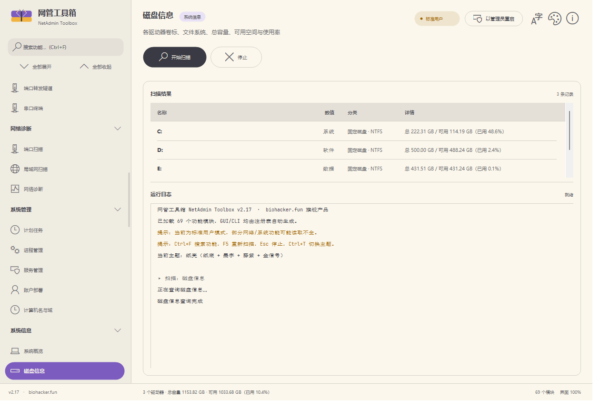

# NetAdmin Toolbox

**A single-file, portable, extensible Windows administration toolkit** — disk cleaning, network diagnostics, system management, software management, malware purge, remote terminal and more, packed into one ~3.5 MB `exe` with zero runtime dependencies.

   

**v2.17 · 69 modules · 15 groups** · VI-D2 branded UI · Pure Win32 owner-draw · **No third-party libraries** · Chinese / Traditional Chinese / English UI



---

## Highlights

| Area | What you get |
| --- | --- |
| **Purge Center** | Rogue-software scanner in the spirit of SoftCnKiller: 13 detection points (processes / services / drivers / kernel modules / hidden processes / autoruns / scheduled tasks / shell extensions / IMEs / file associations / browser extensions / hosts / proxy), Authenticode signature verification, 4-step verdict with strict false-positive control, backup-before-act + one-click undo, **online rule updates** (dual sources, SHA256-checked). Plus a visual custom-rule builder, a built-in **YARA-subset engine** (zero dependencies), homepage-hijack repair/policy lock, and **Windows Update locking** (ghost-image-grade: group policy + service disable incl. WaaSMedic self-heal counter + scheduled tasks + optional hosts block). |
| **Remote Terminal** | Session manager (SSH/SFTP/Telnet) and port-forward tunnels (-L/-R/-D) built on the **Windows built-in OpenSSH** client, plus a COM-port serial monitor. |
| **Mesh Assistant** | Client onboarding for self-hosted **Tailscale / headscale** controllers: paste a config string (`NATBMESH1\|server\|preauth-key`) or scan a **QR code generated by the built-in, dependency-free QR encoder** (byte mode, ECC M, versions 1–10, verified against zxing-cpp). One-click join/leave/status. |
| **Networking** | DNS benchmark & auto-optimize (9 public resolvers, raw UDP probing, applies via `Set-DnsClientServerAddress`), graphical **hosts editor** (auto backup + read-only attribute handling), adapters / connections / routes / ARP / Wi-Fi, LAN scan, port scan, share deployment & drive mapping. |
| **Password tools** | Asterisk password reveal (standard Win32 edit boxes), ZipCrypto recovery (mask/dictionary, multi-threaded, self-implemented INFLATE + CRC32 verification), Credential Manager reader, Wi-Fi password reader. |
| **Cleanup & space** | Rule-driven cleaning (Winapp2-compatible), 17 + 12 built-in targets, WeChat/QQ cleaners, large/duplicate/similar file finders (dHash perceptual hashing), app-mover (junction-based, reversible). |
| **System management** | Process / service / scheduled-task management, account deployment, domain join/leave, share hosting one-click setup, event log analysis, restore points, power plans, Windows optimizer (40 reversible tweaks), winget-based software manager. |

## Release history (recent)

| Version | Key additions |
| --- | --- |
| v2.17 | Full-UI rebrand to the biohacker.fun **VI-D2 "Metamorphosis Wing"** design system: paper/ink dual themes (Ctrl+T), butterfly vector logo + `biohacker·fun` wordmark (GDI+ AA), embedded Baloo 2 / JetBrains Mono subsets (OFL 1.1), brand empty/error states, splash screen, About-page morph timeline, WCAG-AA verified tokens (69 modules unchanged) |
| v2.16 | Mesh Assistant (`net.mesh`): headscale/Tailscale onboarding, config-string import, built-in QR encoder |
| v2.15 | Update locker (`purg.wulock`), graphical hosts editor, DNS optimizer (`net.dnsopt`), i18n expansion, **Remote Terminal** group (`net.sessions` / `net.tunnel` / `net.serial`) |
| v2.14 | Purge Center II: rule builder (`purg.rules`), YARA scanner (`purg.yara`), homepage lock (`purg.homepage`), kernel-module & hidden-process detection |
| v2.13 | Purge Center M1: full-disk rogue scanner (`purg.scan`) + online signature updates |
| v2.11–v2.12 | Password tools group; input persistence, silent elevation, structured domain join, tri-language UI |
| v2.6–v2.10 | Theme system, scalable owner-draw UI, accordion navigation, account/domain/share deployment modules |

## Why NetAdmin Toolbox

Built around the real daily workflows of Windows administrators:

| Scenario | Modules |
| --- | --- |
| Slow machine, full C: drive | Disk cleanup, space analysis, duplicate files, large files |
| Network troubleshooting | Diagnostics (ping/DNS/TCP), routes, ARP, adapter info |
| Find which process owns a port | TCP/UDP table with owning process, port scan |
| Discover devices on the LAN | LAN scan (ping sweep + MAC + reverse hostname) |
| Audit a machine | System overview, disks, processes, services, startup, hotfixes, env vars |
| Fix hosts / speed up DNS | Graphical hosts editor (backup/undo), DNS benchmark & auto-pick, flush DNS |
| Routine maintenance | Process/service/task management, event log analysis, one-click health check & repair |
| New machine setup | Windows optimizer (40 tweaks, reversible) + winget software manager (63 curated apps) |
| Remove Chinese rogue software | Purge Center: signature/directory scan → act → **undo** |
| Lock Windows Update on fleet machines | `purg.wulock`: image-grade lock, fully reversible |
| Onboard machines to a mesh VPN | `net.mesh`: paste config string / scan QR → joined |

## Credits & inspiration

Architecture and UI ideas drawn from these projects:

| Project | What we learned |
| --- | --- |
| [hellzerg/optimizer](https://github.com/hellzerg/optimizer) | Category-grouped modular design |
| [Angry IP Scanner](https://angryip.org/) | LAN discovery approach |
| [Nmap](https://nmap.org/) | Common port list & timeout strategy |
| [BleachBit](https://www.bleachbit.org/) / [Winapp2.ini](https://github.com/MoscaDotTo/Winapp2) | Rule-driven cleaning |
| [Czkawka](https://github.com/qarmin/czkawka) | Perceptual hash for similar images (re-implemented with WIC + dHash) |
| [SoftCnKiller data repo](https://gitee.com/softcnkiller/data) by 四海一叶秋 | Rogue-software signature database (sign/folder/whitelist), credited in-app |
| [headscale](https://github.com/juanfont/headscale) | Self-hosted Tailscale control server; onboarding flow for `net.mesh` |

The UI is drawn with pure Win32 owner-draw following the Fluent Design language — **no third-party UI framework**.

## Extensible plugin framework

**The GUI and CLI contain zero module-specific code.** They only know the `IModule` interface and the `ModuleRegistry`; both render themselves dynamically from the registry. Adding a feature never touches the UI.

### Adding a module = 3 steps

1. Create `src/modules/mymod.cpp`
2. Implement `IModule`
3. Append `REGISTER_MODULE(MyClass);`

```cpp
#include "../module.h"

namespace mz {
namespace {

class MyMod : public IModule {
public:
    const wchar_t* Id() const override { return L"demo.mymod"; }   // unique ID (CLI)
    const wchar_t* Group() const override { return L"My Tools"; }  // sidebar group
    const wchar_t* Title() const override { return L"Demo"; }
    const wchar_t* Description() const override { return L"One-liner"; }
    ModuleKind Kind() const override { return ModuleKind::Inventory; }

    void Run(ModuleContext& ctx, ModuleResult& out) override {
        ctx.Report(0, L"Working...");        // progress callback
        ctx.Log(L" Goes to the log panel");  // log callback
        if (ctx.Cancelled()) return;         // cancellation support

        ModuleRow r;
        r.c1 = L"Name"; r.c2 = L"Value"; r.c3 = L"Category"; r.c4 = L"Detail";
        out.rows.push_back(r);
        out.summary = L"Done: 1 item";
    }
};

REGISTER_MODULE(MyMod);

} // namespace
} // namespace mz
```

`build.bat` globs `src/modules/*.cpp`, so **no build-script changes needed**. The module appears in the sidebar and in `netadmin-toolbox --list` automatically.

### Interface quick reference

| Member | Purpose |
| --- | --- |
| `Id()` | Unique ID, e.g. `net.portscan` (used by CLI) |
| `Group()` | Sidebar group name; same group auto-grouped |
| `Title()` / `Description()` | Display name & subtitle |
| `Kind()` | `Inventory` / `Cleaner` / `Action` / `Tweaks` (toggle + undo) / `Console` |
| `NeedsPath()` / `NeedsTarget()` | Show path box / target box |
| `NeedsElevation()` | Suggest running as admin |
| `SetInput(path, target)` | Receive GUI/CLI input |
| `Actions()` / `RunAction(ctx, i, out)` | Extended action buttons (primary / undo / overflow menu) |
| `SetSelection(rows)` / `SupportsUndo()` / `Undo(ctx, out)` | Row selection & undo (Tweaks) |
| `Run(ctx, out)` | Main logic |
| `Apply(ctx, out)` | Clean/apply logic (Cleaner/Tweaks) |

`ModuleContext` provides `Log()`, `Report(pct, msg)`, `Cancelled()`. `ModuleResult` returns `rows` (4-column table), `summary`, `hint`, `canClean`.

## Built-in modules (69, in 15 groups)

### System Management (5)
| ID | Function |
| --- | --- |
| `sys.process` | Process manager: memory-sorted, parent lookup, kill selected (protected-process blacklist) |
| `sys.services` | Service manager: start/stop/pause/restart + start-type switching, post-action state polling |
| `sys.tasks` | Scheduled tasks: Task Scheduler COM full enumeration (incl. hidden), run/end/enable/disable/delete |
| `sys.acct` | Account deployment: create/update local accounts, auto-logon setup/remove (danger), delete account |
| `sys.domain` | Computer name & domain: rename, join domain (optional OU), leave to workgroup; stops after 2 consecutive failures |

### System Info (5)
| ID | Function |
| --- | --- |
| `sys.info` | OS version, CPU, memory, architecture, hostname, uptime |
| `sys.disk` | Volumes: label, filesystem, total/free, usage (red > 90%) |
| `sys.startup` | Autoruns: registry Run (HKCU/HKLM/WOW64) + startup folders |
| `sys.hotfix` | Installed updates: real KB numbers parsed from CBS packages |
| `sys.env` | Environment variables (user/system), `REG_EXPAND_SZ` expanded |

### System Maintenance (1)
| ID | Function |
| --- | --- |
| `sys.hosts` | Hosts file: parsed view; graphical editor (multiline editing, add mapping, block-domain template), auto `hosts.bak` backup + read-only attribute handling, one-click undo |

### Network Management (10)
| ID | Function |
| --- | --- |
| `net.adapters` | Adapters: IP/IPv6, gateway, DNS, MAC, link speed, state |
| `net.dnsopt` | DNS optimizer: 9 public resolvers benchmarked via raw UDP queries (3 rounds, best latency); auto-pick top 2; apply per-adapter via PowerShell `Set-DnsClientServerAddress`; restore to DHCP; flush cache; shows current per-adapter DNS |
| `net.conn` | Connections: full TCP/UDP table + listening ports + owning process |
| `net.route` | Routing table |
| `net.arp` | ARP table (dynamic/static) |
| `net.wifi` | Wi-Fi networks: SSID, signal, auth, channel |
| `net.flushdns` | Flush DNS cache (action) |
| `net.sharehost` | Share deployment one-click: 14-item health check (services, firewall rule groups via INetFwPolicy2, network profile, security keys, SMB1 read-only); one-click open / restore conservative; per-item GPO-grade edits in overflow menu (all danger-confirmed) |
| `net.sharemap` | Share scan & drive mapping: host discovery (NetServerEnum + Ping), 445 pre-probe, NetShareEnum, map/unmap drive letters (session-only credentials) |
| `net.mesh` | Mesh assistant (v2.16): headscale/Tailscale onboarding — clipboard config-string import (`NATBMESH1\|server\|preauth-key`, tolerant of whitespace/quotes, key masked + DPAPI-encrypted), **built-in QR encoder** (zero dependencies; bitmap dialog in GUI, half-block Unicode in CLI), join network (detect client → winget silent install → `tailscale up` → status confirm), leave network, `tailscale status --json` node listing, client detection, logout/reset (danger) |

### Network Diagnostics (3)
| ID | Function |
| --- | --- |
| `net.diag` | Ping (4-round stats), DNS resolution, TCP connectivity |
| `net.portscan` | Port scan: 20+ common ports, non-blocking connect with timeout |
| `net.lanscan` | LAN scan: auto /24 sweep, ping + MAC + hostname |

### Security Check (2)
| ID | Function |
| --- | --- |
| `sec.scan` | 8-item read-only health check: UAC, Defender, firewall profiles, disk space, update lag, sfc integrity, critical services, restore service |
| `sec.repair` | 9 repair actions: sfc, DISM RestoreHealth/ScanHealth, chkdsk (read-only / scheduled), Winsock reset, network stack reset, Defender quick scan & update — all streamed line-by-line, cancellable |

### Purge Center (5)
| ID | Function |
| --- | --- |
| `purg.scan` | Full rogue-software scan: 13 detection points (incl. kernel modules & hidden processes via NT internals — v2.14); Authenticode verification (WinVerifyTrust + certificate subject); SoftCnKiller signature DB (396 signatures + 1130 directory patterns + whitelist, base64-embedded to avoid AV content false positives); 4-step verdict (whitelist → MS-signed allow → signature blacklist → directory pattern); acts with prior backup (`purg-backup.tsv`) and one-click **reverse-order undo**; online DB updates (gitee SoftCnKiller + GitHub extra rules, row-threshold + SHA256 checks, source configurable via `rules\update.ini`) |
| `purg.rules` | Visual rule builder (v2.14): custom signature / directory / whitelist rules in `rules\custom_*.txt` (separate from online-update layer), add/delete/dedupe/length validation, export rule pack |
| `purg.yara` | YARA scanner (v2.14): self-implemented YARA subset, zero dependencies — text strings (ascii/wide/nocase/fullword), hex strings (`??`, `[n]`/`[n-m]`/`[n-]` jumps), conditions (`$a at N`, and/or/not, any·all·N of them, filesize with KB/MB); rules in `rules\yara\*.yar`; unsupported constructs are skipped with logging |
| `purg.homepage` | Homepage guard (v2.14): IE homepage & search-engine hijacks, Edge/Chrome policy hijacks, shortcut URL hijacks; repair + set target homepage (TSV backup, undo); policy-level lock/unlock; Microsoft default pages de-noised |
| `purg.wulock` | Windows Update locker (v2.15): scans policy/services/tasks/hosts lock state; **lock** = 5 group-policy values + service disable (incl. `WaaSMedicSvc` registry `Start=4` + FailureActions self-heal patch) + both update task folders disabled + optional hosts block (flagged comments); full backup `wulock-backup.tsv`, one-click restore; non-elevated failures are honestly counted with localized attribution (see [docs/dev-notes-wulock.md](docs/dev-notes-wulock.md) for the full ghost/ESD research) |

### Password Tools (4)
| ID | Function |
| --- | --- |
| `pwd.reveal` | Asterisk password reveal: standard Win32 password boxes (Edit/RichEdit + ES_PASSWORD), cross-process WM_GETTEXT; custom-drawn UIs (browsers) not supported by design |
| `pwd.zip` | ZIP password recovery: legacy ZipCrypto brute force (mask/dictionary), multi-threaded & cancellable; hit = 12-byte check → full decrypt → self-implemented INFLATE → CRC32; GBK + UTF-8; AES/7z/RAR explicitly unsupported |
| `pwd.cred` | Credential Manager: CredEnumerate with smart UTF-16/UTF-8/Base64 blob decoding; domain passwords hidden by system design |
| `pwd.wifi` | Wi-Fi passwords: `netsh wlan show profile key=clear` with bilingual (CN/EN) profile parsing |

### Remote Terminal (3)
| ID | Function |
| --- | --- |
| `net.sessions` | Remote sessions: SSH/SFTP/Telnet profiles (persisted to `netadmin-sessions.ini`); connect via Windows built-in OpenSSH in a new console; passwords never stored (interactive or pubkey auth); one-click OpenSSH client install |
| `net.tunnel` | Port-forward tunnels: -L local / -R remote / -D dynamic SOCKS, generates `ssh -N`; start/stop/stop-all with live state; definitions persisted |
| `net.serial` | Serial terminal: COM enumeration (QueryDosDevice), DCB config, monitor receive + send-and-read; interactive TUI deferred |

### Everyday Admin (6)
| ID | Function |
| --- | --- |
| `sys.restore` | Create restore point (custom description; frequency-limit/disable attribution) |
| `sys.users` | Local users: enumerate, enable/disable (built-in accounts protected) |
| `sys.shares` | Shared folders: enumerate & unshare (IPC$/ADMIN$/X$ read-only protected) |
| `sys.events` | Event log analysis: last-7-days System/Application errors aggregated by source+ID (top 20) |
| `sys.power` | Power plans: enumerate & switch + unlock "Ultimate Performance" |
| `sys.update` | Missing Windows updates (check only, no install) |

### Disk Cleanup (5)
| ID | Function |
| --- | --- |
| `clean.basic` | 17 targets: temp files, browser caches, recycle bin, app caches |
| `clean.system` | 12 targets: logs, update cache, WinSxS, hibernation, pagefile |
| `clean.wechat` | WeChat (3.x / 4.x) cleanup |
| `clean.qq` | QQ / NTQQ cleanup |
| `clean.appcache` | App cache (Winapp2 rule engine) |

### Space Analysis (6)
`scan.large` large files · `scan.dup` duplicates (3-tier hashing) · `scan.similar` similar files · `scan.similarimg` similar images (dHash) · `scan.dirs` directory sizes · `scan.apps` app footprint

### Advanced Tools (2)
`tool.move` app relocation (junctions, reversible) · `tool.usermigrate` user-profile migration

### System Optimization (1)
`tweak.winopt` Windows optimizer (40 reversible tweaks)

### Software Manager (11)
| ID | Function |
| --- | --- |
| `soft.rec` | Curated essentials: 63 free apps with installed/version status |
| `soft.rec.*` (6) | Category boards: browsers, compression, office, dev, media, chat, system/security |
| `soft.search` | winget search (keyword in target box), one-click install/uninstall |
| `soft.installed` | Installed list (winget list), select & uninstall |
| `soft.upgrade` | Upgradable list (winget upgrade), select & update |

> Requires system winget. Missing winget → in-app install guidance, no crash. Install/uninstall run hidden with captured output; failures listed in log & summary; Esc cancels.

## Usage

### GUI

Double-click `netadmin-toolbox.exe` (no arguments → GUI).

- Left sidebar lists all modules by group
- Modules needing input show path/target boxes automatically
- Bottom log streams progress in real time
- "Restart as administrator" (top-right) elevates when needed

**Shortcuts & UI:**

| Action | Effect |
| --- | --- |
| `Ctrl+F` / sidebar search | Live module filter (title/description/ID) |
| `F5` | Re-run current module scan |
| `Esc` | Stop running task; closes modal dialogs |
| `Ctrl+T` / Theme button | Cycle 4 themes (clear-day / warm-sand / mist-blue / deep-night) |
| `Ctrl + =` / `Ctrl + -` / `Ctrl + 0` | Zoom UI 85%–180%, persisted |
| Column header click | Sort results (toggle asc/desc) |
| Top-right About | Version info + website |

### CLI

```bat
netadmin-toolbox.exe                         :: launch GUI
netadmin-toolbox.exe --list                  :: list all modules
netadmin-toolbox.exe --help                  :: help

:: run a module by ID
netadmin-toolbox.exe run sys.info
netadmin-toolbox.exe run clean.basic

:: with input
netadmin-toolbox.exe run net.diag     --target 8.8.8.8
netadmin-toolbox.exe run net.portscan --target 192.168.1.1
netadmin-toolbox.exe run scan.large   --path D:\ --target 500

:: actions (--action N, 0-based) and row picking (--pick name|PID)
netadmin-toolbox.exe run sys.process --action 0 --pick notepad.exe   :: kill process
netadmin-toolbox.exe run purg.wulock                                 :: scan update-lock state
netadmin-toolbox.exe run purg.wulock --action 0                      :: lock Windows Update

:: v2.16 mesh assistant
netadmin-toolbox.exe run net.mesh                                    :: scan mesh status
netadmin-toolbox.exe run net.mesh --action 2                         :: import config string from clipboard
netadmin-toolbox.exe run net.mesh --action 3                         :: print QR code (terminal half-blocks)

:: password tools
netadmin-toolbox.exe run pwd.zip --path D:\docs\backup.zip --target d:4-8          :: 4-8 digit mask
netadmin-toolbox.exe run pwd.zip --path D:\docs\backup.zip --target dict:D:\dict.txt
```

Exit codes: `0` success, `1` argument/module error.

### Winapp2 rules

41 curated app sections are built in. For the full community set (thousands), drop [Winapp2.ini](https://github.com/MoscaDotTo/Winapp2) next to the exe — it is loaded with priority and dangerous-path filtering.

## Build

```bat
build.bat          :: incremental build
build.bat clean    :: clean rebuild
```

Requirements: **MinGW-w64 g++ ≥ 12** (verified with 16.2.0). Point the `MINGW` variable in `build.bat` to your toolchain. Everything else is Windows SDK only — **no third-party libraries**.

### Source layout

```
src/
  main.cpp          entry: args → CLI, none → GUI
  module.h/.cpp     ★ plugin framework (interface + registry)
  cli.cpp           ★ CLI (dispatched from registry)
  common.h/.cpp     UTF-8 / size formatting / elevation / hidden execution
  procrun.h/.cpp    streaming process runner (line output / cancel / timeout)
  cleanresult.h/.cpp clean-result model + Win32/HRESULT error attribution
  cleaner.h/.cpp    disk cleaning & analysis engine
  winapp2.h/.cpp    Winapp2 rule engine
  simhash.h/.cpp    image dHash perceptual hashing
  regengine.h/.cpp  .reg parser + registry I/O
  debloat.h/.cpp    Windows optimizer
  qr.h/.cpp         ★ dependency-free QR encoder (byte mode, ECC M, v1–v10)
  lang.h/.cpp       i18n: zh-CN / zh-TW / en-US (binary-search lookup table)
  ui/               ★ UI layer (themes / scaling / cards / full owner-draw)
  modules/          one .cpp per feature area (see above tables)
  app.rc / app.manifest
data/               embedded rule sets & optimizer metadata
docs/               design notes & diagrams
tools/              QA & test scripts
```

★ = framework core — normally **not touched** when extending.

## Verification (summary)

| Area | Result |
| --- | --- |
| Registry | 69 modules / 15 groups, sidebar + CLI auto-generated |
| CLI | `--list` / `run <id>` / `--action` / `--pick` all verified |
| Network | Live-tested: adapters, 392 TCP + 69 UDP entries, LAN scan aligned with NetServerEnum |
| Purge Center | 4-step verdict live-tested: 0 false positives on 111 processes / 279 services / 198 MS-signed drivers; controlled hits on signature/whitelist/directory channels; online update dual-source download + SHA256 verified |
| YARA engine | Hex rules (MZ@0 + UPX!@64KB) and text rules hit; clean files 0 false positives |
| QR encoder | 5 payload sizes (37B–213B) round-trip decoded with zxing-cpp, all byte-identical; 214B correctly rejected |
| DNS optimizer | 14 public resolvers benchmarked live (8–189 ms), sorted, applied correctly |
| Update locker | Non-elevated lock attempts honestly report per-item "access denied" with zero registry side effects; backup/restore TSV round-trip verified |
| Password tools | pwd.zip 10/10 cases (mask/dictionary/real 7-Zip zips, zero false positives); INFLATE stress 27/27 vs zlib |
| Winapp2 engine | Parser proven line-equivalent against an independent Python reference (80/80 files, 326/326 operations) |
| GUI | Smoke, navigation, sorting, dialog close paths, theme switch, zoom — all scripted-assertion verified |
| Single file | ~3.5 MB, no installer, no service, no driver, no third-party DLLs |

## Known limitations

1. **Elevated write paths need admin-machine regression**: service start/stop, task deletion, restore points, account/domain operations, share deployment, purge actions, update locking — non-elevated runs verify the "correct refusal + localized attribution" path only; they never fake success.
2. **Non-admin runs see less data**: some process names and service start types are restricted; the app reports this honestly.
3. **LAN/port scanning** must only target networks you are authorized to test.
4. **Deliberately not done**: pagefile relocation, hibernation off, automatic WinSxS cleanup — high-risk operations are read-only or instruction-only by design.
5. **winget operations recommend elevation** (machine-scope installers trigger UAC); a few installers still show their own UI.
6. **Hosts editing** always backs up to `hosts.bak` first and restores the read-only attribute afterwards.
7. **Remote terminal**: connection passwords are never persisted; tunnel handles live only while the app runs; serial interactive TUI deferred.
8. **Antivirus**: unsigned releases may trigger heuristics on some engines (signature data is base64-embedded to avoid content scanning, and NT-internals detection is used only for hidden-process discovery). Signed releases are recommended for fleet deployment.
9. Some rarely-installed software paths report nothing on machines where they simply don't exist.

## License & Donations

**NetAdmin Toolbox is free and open source under the [MIT License](LICENSE).** You may use, modify and redistribute it freely — including commercially.

If it saves you time, the author's only form of support is **donations**:

- GitHub Sponsors: <https://github.com/sponsors/third8923>

---

*NetAdmin Toolbox — part of the biohacker.fun toolbox family.*
