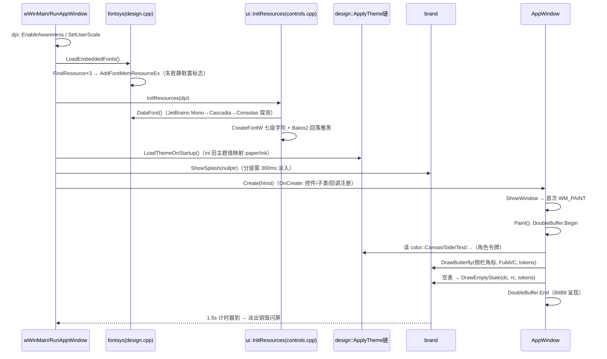
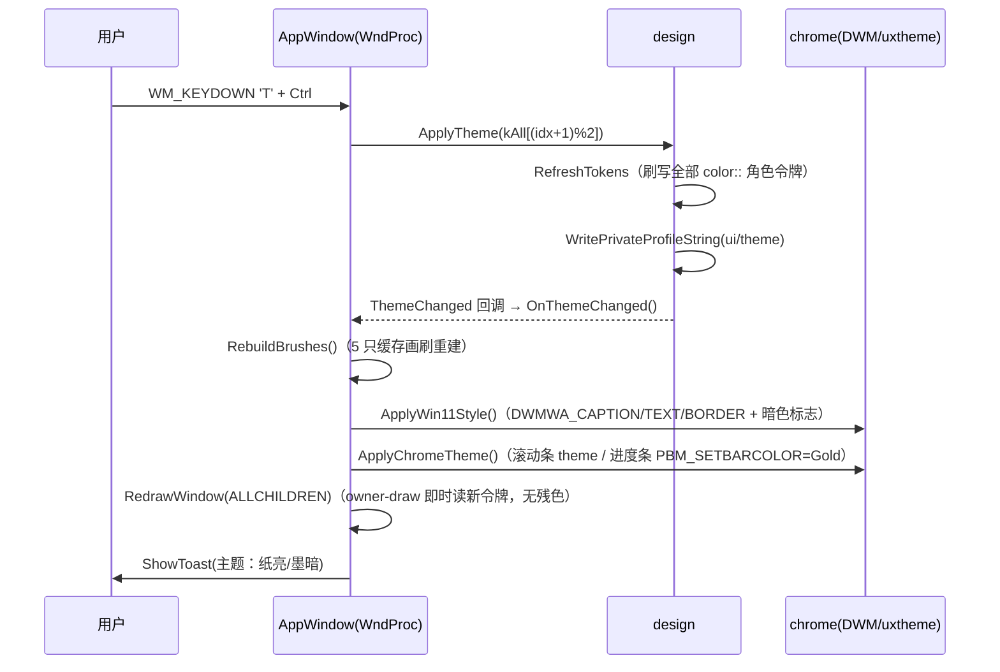
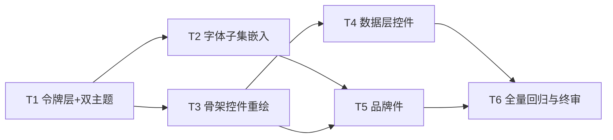

# NetAdmin Toolbox v2.17 UI 重构 —— VI-D2「蜕变之翼」增量架构设计

> 撰写：高见远 · 架构师（Bob）
> 输入：`docs/prd-ui-vi.md`（PRD）、`docs/vi-d2-tokens.md`（Token 规范，最高依据）、`vi-manual-D2.pdf`
> 改造边界：**只动 `src/ui/`、`src/app.rc`、`src/lang.cpp`（新增键）、`build.bat`（加 -lgdiplus）与 `tools/`；`src/modules/` 零改动**

---

## 1. 实现方案

### 1.1 现状盘点（改造面清单，基于全量源码阅读）

| 现有资产 | 位置 | 与本次重构的关系 |
|---|---|---|
| 4 主题（Palette 结构 + inline `color::` 令牌 + `ApplyTheme`/ini 持久化/回调通知） | `src/ui/design.h/.cpp` | **重写**：Palette→ThemeTokens（VI-D2 全量 token），4 主题→纸亮/墨暗；持久化与回调机制保留复用 |
| 字体阶梯（`font::` 常量 + `controls.cpp InitResources` 创建雅黑/MDL2 字体） | `design.h` + `controls.cpp` | **重写**：七级字阶 + 三层字体（Baloo 2 800 / YaHei UI / JetBrains Mono）+ 内存字体加载 |
| owner-draw 主窗口绘制（Paint / DrawSidebar / DrawHeader / DrawStatusBar / DrawDataCard / DrawNavItem / DrawButton / ListCustomDraw / HeaderCustomDraw / WM_CTLCOLOR*） | `src/ui/appwindow.cpp` | **局部修改**（重构取色与规格，不改交互逻辑） |
| 按钮/搜索框/Toast/日志视图 | `src/ui/controls.cpp` | **局部修改**（胶囊化、信号金、通道色日志） |
| 模态框架（ModalHost / ConfirmPage / AboutPage / ThemePickerPage） | `src/ui/dialog.cpp` | **局部修改**（确认框墨色危险键、关于页重做、主题卡 4→2） |
| GDI RAII + 双缓冲 + 圆角（`CreateRoundRectRgn` 无抗锯齿） | `src/ui/gdi.cpp` | **局部修改**：圆角改 GDI+ 路径抗锯齿 |
| dpi::S() 定点缩放 | `src/ui/dpi.cpp` | 零改动（新 token 尺寸全部过 S()） |
| 图标 APPICON（DNA 螺旋，tools/gen_icon.py 生成） | `src/app.rc` | **替换**为蝶形符号 E 变体（多尺寸） |
| Ctrl+T 循环主题、主题按钮、主题日志行 | `appwindow.cpp` WndProc | 4 循环→2 循环 |

**关键发现**：现有 `gdi.cpp` 是纯 GDI（无 GDI+）。蝶形标志、45° 走线、圆环焊盘、四态线稿必须抗锯齿矢量，因此引入 **GDI+（GdiplusFlat，系统组件非第三方库）**，`build.bat` 增加 `-lgdiplus`，`gdi.cpp` 增加 `GdiplusStartup/Shutdown` 生命周期。

### 1.2 分层架构（增量改造，不动交互骨架）

```
┌─ 绘制层（局部改）────────────────────────────┐
│ appwindow.cpp / controls.cpp / dialog.cpp     │  只引用「角色令牌」与 brand API
│   引用: color::Canvas / Panel / Accent / ...  │  禁止出现裸 HEX
├─ 品牌层（新增）──────────────────────────────┤
│ brand.h/.cpp  蝶形 A/B/C/E · 字标 · 空态/错误态 │  构造参数直译，GDI+ 抗锯齿
│               · 四态叙事 · 闪屏                │  唯一允许引用身份色原值的绘制方
├─ 令牌层（重写）──────────────────────────────┤
│ design.h/.cpp  ThemeTokens（亮/暗两实例）      │  color:: 角色令牌 = 手册 token
│                fontsys 内存字体 + 七级字阶      │  的主题化映射；ApplyTheme 复用
├─ 基础设施（微调）────────────────────────────┤
│ gdi.cpp(GDI+ AA 圆角) / dpi.cpp(不动) / lang   │
└──────────────────────────────────────────────┘
```

**核心策略——令牌桥接，避免一次性翻写 2500 行绘制代码**：
T1 重写 design 层时，`color::` 命名空间**保留全部旧变量名作为新角色令牌的别名**（如 `color::Bg` → 指向 `Canvas`，`color::Primary` → 指向 `Accent`），使全仓在 T1 后立即可编译、立即呈现 VI 配色；T3/T4/T5 逐控件把调用点替换为规范令牌名并删除别名。这样每个任务独立可验收、可回退。

### 1.3 字体嵌入方案

- **子集生成**（离线一次，产物入库）：`tools/fontsubset/gen_fonts.py` 用 fonttools `pyftsubset` 裁剪：
  - `Baloo2-ExtraBold`：U+0020–007E（基础拉丁 + 数字 + 标点，覆盖 "NetAdmin Toolbox" / "biohacker.fun" / 版本号），产物约 12–18 KB；
  - `JetBrainsMono-Regular` / `JetBrainsMono-SemiBold`：U+0020–007E + U+00B7（中点，字标金点前的分隔符），各约 25–35 KB；
  - 中文**绝不进**子集：Display 层只画拉丁字标与数字；正文中文走雅黑；等宽行里的中文由 GDI 字体链接（font linking）自动回落雅黑。
- **嵌入**：`src/app.rc` 增加 3 行 `RCDATA`（windres `-I%SRC%` 已配好，路径 `res/fonts/*.bin` 相对 src）。总体积增量 ≈ +70–90 KB（预算 300 KB 内）。
- **加载时序**：`wWinMain → RunAppWindow → fontsys::LoadEmbeddedFonts()`（FindResourceW → LockResource → `AddFontMemResourceEx`，返回值校验 nFonts>0），**必须先于** `ui::InitResources()`——因为 InitResources 按字族名 `CreateFontW(L"Baloo 2")`，内存字体必须已注册。加载失败静默降级（见 1.5 回落）。
- **OFL 许可**：`src/res/fonts/OFL.txt` 随仓保留两字体各自 license 全文；`design.cpp` 文件头注释声明 "Baloo 2 / JetBrains Mono — SIL Open Font License 1.1, embedded as subset under OFL-labeled embedding terms"；关于页脚注一行三语文案（lang 新键）。

### 1.4 蝶形标志绘制模块（brand.h/.cpp）

手册第 4 节构造参数**逐项直译**为常量表（唯一真值来源，`brand.cpp` 顶部）：

```
画布 240×160（12×8 网格，单元 u = H/8，H=绘制高度）
上翅 192×62 ×2（藤紫 wing，墨底时 wing_on_ink）    下翅 96×44 ×2（金 signal，实心）
蝶身 宽 12u（墨 / 反白时纸）    触角 长 22u · 仰角 45°
焊盘 圆环外径 12u（金）×2 于上翅走线末端        过孔 实心点 r 2.8u ×2 于翅根
走线 仅 45° 折线，宽 3.5u；标注引线 1.5u（两档线宽，无第三档）
净空间 = 外切矩形高的 1/2（DrawButterfly 内部自动收缩 fit 矩形）
```

API（详见 §3）：`DrawButterfly(dc, fit, variant, theme)` / `DrawWordmark` / `DrawEmptyState` / `DrawErrorState` / `DrawMorphTimeline` / `ShowSplash`。变体：
- **A 完整**（纸底）：wing + signal + ink 身；
- **B 单色墨**：全部 ink（纸底单色场景）；
- **C 反白**（墨底）：蝶身 paper、上翅 `wing_on_ink`、焊盘保持金——**C 变体代码路径中不存在 wing 原色**（用断言/单测防回归）；
- **E 24×24 方瓣圆头**：符号化蝶（任务栏/标题栏图标的最小几何蓝本，`tools/gen_icon.py` 用同一坐标表离线产出 16/24/32/48/256 ico）。

实现：GDI+ `Graphics(FromHDC)` + `SmoothingModeAntiAlias` + `GraphicsPath`（AddPolygon/AddArc），颜色一律从传入 token 取。禁止 skew/渐变/外发光/硬投影——代码中不出现对应 GDI+ 调用即为合规。

### 1.5 空态 / 错误态 / 闪屏 / 四态叙事

- **空态**（替换 `ListCustomDraw` CDDS_PREPAINT 里的圆底图标空态）：`brand::DrawEmptyState` = panel 底上 line 色 45° 走线两段 + 一枚**未画完**的焊盘开口圆弧 + 金 via 一枚 + ink55 引导文案（lang 键「信号没到，线就不画完」）。
- **错误态**：`brand::DrawErrorState` = 走线在中间**断开**（两段各留 6u 缺口）+ 1.5u 标注引线指向断点 + ink55 说明与行动建议。**不上红**（ch_err 只归数据徽标）。
- **闪屏**：`brand::ShowSplash(host)`——WS_POPUP 分层窗，纸底（暗主题=墨底）+ 变体 A/C + Baloo 2 字标 + 金点；`SetLayeredWindowAttributes` 300ms 淡入，加载完成或 1.5s 后淡出销毁；在 `AppWindow::Run()` 中 `Create()` 之前显示、主窗 `ShowWindow` 之后淡出。不铺金（金只出现在 2 焊盘 + 金点 ≪10%）。
- **四态叙事**（仅关于页）：`brand::DrawMorphTimeline`——卵(v0.1)→幼虫(v0.5)→蛹(v0.9)→蝶(v1.0) 四格线稿（仅走线/焊盘/过孔语法），跳变点标 via；当前版本 v2.17 落在蝶之后延伸的走线上，**金点=焊盘语义高亮**当前版本；三语文案走 lang。

### 1.6 暗主题派生色推导（相对亮度法，WCAG 公式）

公式：`L = 0.2126R'+0.7152G'+0.0722B'`，`c≤0.04045 → c/12.92`，否则 `((c+0.055)/1.055)^2.4`；对比度 `=(L1+0.05)/(L2+0.05)`。
管线自检：paper #FBF7EC L=0.9308、ink #3A3A44 L=0.04342 → 10.50:1，与手册一致 ✓（方法可信）。

| 派生 token | 推导值 | 对比对象 | 实测对比度 | 判定 |
|---|---|---|---|---|
| `panel_dark` 侧栏/面板底 | **#42424C** | paper 反白文字 | (0.9808)/(0.1058) = **9.27** | ✓ |
| `panel2_dark` 次级填充/表头/进度轨 | **#484852** | paper 文字 | 0.9808/0.1162 = **8.44** | ✓ |
| `line_dark` 描边/分隔 | **#5A5A64** | （非文字，对 ink 1.65:1 可辨） | — | ✓ |
| `ink70_dark` 次级正文 | **#C6C3CC** | ink 底 | 0.6041/0.09342 = **6.47** | ✓ ≥4.5 |
| `ink55_dark` 标签/注记 | **#ACA9B2** | ink 底 | 0.4535/0.09342 = **4.86** | ✓ ≥4.5 |
| `ch_in_dark` 进（墨底变体） | **#57C2A8** | ink / panel_dark | **5.19 / 4.58** | ✓ |
| `ch_out_dark` 出（墨底变体） | **#E8A344** | ink / panel_dark | **5.22 / 4.61** | ✓ |
| `ch_err_dark` 异常（墨底变体） | **#F28B7E** | ink | **4.69** | ✓（仅用于 ink 底，见规则） |
| `accent_soft_dark` 选中柔光底 | **#4A3F63** | paper 文字 | 0.9808/0.1091 = **8.99** | ✓ |
| `accent_hover_dark`（wing_on_ink 悬停加深为提亮） | **#C3ABFD** | ink 文字（OnAccent=ink） | 0.5282/0.09342 = **5.65** | ✓ |
| 亮主题 `accent_soft` | **#E9E2F6** | ink 文字 | 0.8338/0.09342 = **8.93** | ✓ |
| 亮主题 `accent_hover`（加深保证纸字达标） | **#6B4EA8** | paper 文字 | 0.9808/0.164 = **5.98** | ✓ |
| 亮主题 `ch_err_soft` 危险行底 | **#F8EAE7** | ch_err #B3453B 文字 | 0.8957/0.1915 = **4.68** | ✓ |
| 暗 `ch_err_soft` | **#463338** | ch_err_dark 文字 | 0.4884/0.0896 = **5.45** | ✓ |

**墨底纪律（写入 token 层注释，违者打回）**：墨底唯一彩色 = 金 #F2B441；紫一律 #B293FC；徽标规则 = 亮主题「通道色实底 + paper 字」、暗主题「通道色暗变体实底 + ink 字」（ch_in_dark 5.19 / ch_out_dark 5.22 / ch_err_dark 4.69 对 ink 全部达标）；**暗主题数据面（表格/日志）一律铺 ink，panel_dark 只用于侧栏与 chrome**——这是 ch_err_dark 在 panel_dark 上 4.14 不达标问题的结构性解法。

### 1.7 双主题完整映射表（token → 值）

| Token（代码名） | 纸亮（默认） | 墨暗 | 手册依据 |
|---|---|---|---|
| Paper / Ink / Wing / Signal | #FBF7EC / #3A3A44 / #7C5CBF / #F2B441 | 同左（身份色不变） | §1 四主色 |
| SignalText | #9F6500 | =Signal #F2B441 | 强制变体 / 墨底唯一彩 |
| WingOnInk | #B293FC | #B293FC | 强制变体 |
| ChIn / ChOut / ChErr | #2F7D6B / #9F6500 / #B3453B | #57C2A8 / #E8A344 / #F28B7E | §1.6 推导 |
| Panel / Panel2 / Line | #EFECE2 / #E4E0D8 / #D4D1CA | #42424C / #484852 / #5A5A64 | 手册 + §1.6 |
| Ink70 / Ink55 | #646469 / #706F73 | #C6C3CC / #ACA9B2 | 手册 + §1.6 |
| **Canvas**（主区/卡片/日志底） | paper | ink | 4.1/4.2 映射表 |
| **Side**（侧栏） | Panel | panel_dark | 4.1/4.2 |
| **Hover**（悬停面） | Panel2 | panel2_dark | — |
| **Text / Text2 / Text3** | ink / ink70 / ink55 | paper / ink70_dark / ink55_dark | ≥4.5 全达标 |
| **Accent**（选中/焦点环） | wing | wing_on_ink | 4.74 / 4.53 |
| **OnAccent** | paper | ink | 4.1/4.2 |
| **AccentHover / AccentPressed** | #6B4EA8 / #5C4290 | #C3ABFD / #9F80E8 | §1.6 |
| **AccentSoft** | #E9E2F6 | #4A3F63 | §1.6 |
| **BtnFill / BtnText**（主按钮=反白钮） | ink / paper | paper / ink | 4.1/4.2 |
| **Gold**（信号：进度/焊盘/金点） | signal | signal | 墨底唯一彩 |
| **GoldText**（底上金色小字） | signal_text | signal | 4.52 / 6.09 |
| **Hairline**（行分隔） | line | line_dark | — |
| **Cap / CapText**（DWM 标题栏） | panel / ink | ink / paper | — |
| **Zebra** | #F3F0E6（panel 微淡） | #42424C（=panel_dark） | 斑马可选 |
| Danger 键（危险确认按钮） | BtnFill/BtnText（墨底纸字，不用红） | 同左 | 4.1「主按钮/危险确认主键」 |
| 数据行 danger | 文字=ChErr、底=ChErrSoft | 同左（暗变体） | ch_err 只归数据层 |

旧 `color::` 别名桥接表（T1 生效、T3–T5 逐步清除）：`Bg→Canvas, Surface→Canvas, SurfaceHi→Hover, SurfaceSel→AccentSoft, Sidebar→Side, SidebarHi→Hover, Console→Canvas, Border→Hairline, BorderSoft→Hairline, Primary→Accent, PrimaryHi→AccentHover, PrimaryDim→AccentPressed, PrimarySoft→AccentSoft, PrimaryDisabled→Blend(Hover,Text3,300), Cyan/CyanSoft→ChIn, Danger*→ChErr 系, Warn→GoldText, WarnSoft→Blend(GoldText,Canvas,900), Ok→ChIn, OkSoft→ChInSoft, Text→Text, TextSub→Text2, TextFaint→Text3, OnPrimary→OnAccent, OnDanger→OnAccent, Zebra→Zebra, Caption→Cap`。T6 验收 grep 时别名已删空。

---

## 2. 文件清单

| 文件（相对项目根） | 性质 | 说明 |
|---|---|---|
| `src/ui/design.h` | **重写** | ThemeTokens 结构 + kPaper/kInk 两实例 + `color::` 角色令牌（含桥接别名）+ 七级字阶常量 + fontsys 声明；保留 SaveUserScale/NavExpanded/ModuleInput 持久化 API 原样 |
| `src/ui/design.cpp` | **重写** | 双主题 RefreshTokens、ApplyTheme/LoadThemeOnStartup（ini 键 theme=paper/ink 兼容旧值映射）、fontsys::LoadEmbeddedFonts/DataFont 回落链；DPAPI/持久化实现原样保留 |
| `src/ui/brand.h` | **新增** | MarkVariant 枚举、DrawButterfly/DrawWordmark/DrawTrace/DrawPad/DrawVia/DrawEmptyState/DrawErrorState/DrawMorphTimeline/ShowSplash 声明 |
| `src/ui/brand.cpp` | **新增** | 手册构造参数常量表 + GDI+ 路径绘制实现（唯一引用身份色原值的绘制方） |
| `src/ui/controls.h` | 局部修改 | res:: 新增 Display/Wordmark/MonoStrong 字体句柄；DrawFluentButton 签名不变 |
| `src/ui/controls.cpp` | 局部修改 | InitResources 七级字阶+三字体层；按钮胶囊 999px/主键墨底；Toast/搜索框/日志取新令牌；日志通道色语义 |
| `src/ui/gdi.h` | 局部修改 | FillRoundRect/StrokeRoundRect 增加 AA 版语义（签名不变） |
| `src/ui/gdi.cpp` | 局部修改 | GdiplusStartup/Shutdown 生命周期 + 圆角改 GDI+ GraphicsPath 抗锯齿（半径≤2 保留 GDI 快路径） |
| `src/ui/appwindow.cpp` | 局部修改 | Run() 启动时序（字体→闪屏）；DrawSidebar（蝶形角标+panel 底+wing 选中+胶囊导航）；DrawHeader（22px 700 页题）；DrawStatusBar；DrawDataCard；DrawNavItem；DrawButton 分发；ListCustomDraw（斑马/分隔/选中柔光/危险行徽标）；HeaderCustomDraw；空态接 brand；Ctrl+T 双主题循环；WM_CTLCOLOR* |
| `src/ui/appwindow.h` | 局部修改 | 新增成员：splash 句柄（如需）；无结构变化 |
| `src/ui/dialog.h` | 局部修改 | ThemePickerDialog 注释更新（2 卡）；无签名变化 |
| `src/ui/dialog.cpp` | 局部修改 | ThemePickerPage 2 卡（纸亮/墨暗迷你预览）；AboutPage 重做（蝶形+字标+四态+OFL 脚注）；ConfirmPage 危险键=墨色 |
| `src/lang.cpp` | 局部修改 | kEn 表新增键（空态/错误态/四态叙事/主题名/字体脚注，约 18 条） |
| `src/app.rc` | 局部修改 | 3 条字体 RCDATA；版本 2,17,0,0 |
| `src/common.h` | 局部修改 | k_AppVersionMinor = 17 |
| `build.bat` | 局部修改 | 链接库追加 `-lgdiplus`（系统组件） |
| `tools/gen_icon.py` | **重写** | 蝶形 E 变体同源坐标表 → 16/24/32/48/256 app.ico |
| `tools/fontsubset/gen_fonts.py` | **新增** | pyftsubset 子集生成脚本（含字符集与说明） |
| `src/res/fonts/baloo2-800-subset.bin` 等 3 个 .bin | **新增** | 子集产物入库 + `OFL.txt` |
| `tools/qa_contrast.py` | **新增** | 从 design.h 解析 token 做 WCAG 批量自检（T6 用） |
| `tools/qa_gold_ratio.py` | **新增** | 截图金色像素占比抽查（≤10%） |

`src/modules/`、`src/cli.cpp`、`src/dpi.*`：**零改动**。

---

## 3. 数据结构与接口

### 3.1 ThemeTokens（design.h，字段 = 全部 token + 角色派生）

```cpp
namespace mz::ui::design {

struct ThemeTokens {
    // ---- 身份层（两主题同值，手册原值）----
    COLORREF Paper, Ink, Wing, Signal, SignalText, WingOnInk;
    COLORREF ChIn, ChOut, ChErr;              // 数据通道（亮底原值）
    // ---- 中性派生 + 墨底变体（§1.7 表）----
    COLORREF Panel, Panel2, Line, Ink70, Ink55;      // 亮=手册原值，暗=派生
    COLORREF PanelD, Panel2D, LineD, Ink70D, Ink55D; // 暗变体（亮主题下同值冗余）
    COLORREF ChInD, ChOutD, ChErrD, ChErrSoftD, ChErrSoft;
    // ---- 区域角色（绘制代码唯一取色入口）----
    COLORREF Canvas, Side, Hover, Text, Text2, Text3;
    COLORREF Accent, OnAccent, AccentHover, AccentPressed, AccentSoft;
    COLORREF BtnFill, BtnText, Gold, GoldText, Hairline, Zebra;
    COLORREF Cap, CapText;
    bool     Dark;
    const wchar_t* id;      // "paper" / "ink"
    const wchar_t* name;    // 纸亮 / 墨暗
    const wchar_t* desc;
};

inline const ThemeTokens kPaperLight{ /*§1.7 亮列*/ };
inline const ThemeTokens kInkDark  { /*§1.7 暗列*/ };
inline constexpr const ThemeTokens* kAll[] = { &kPaperLight, &kInkDark };

namespace color {          // 当前生效令牌：ApplyTheme 统一刷新，调用点零改动
inline COLORREF Canvas = kPaperLight.Canvas;   // …（每个角色一条 inline）
// T1 桥接别名（旧名 → 新角色），T3–T5 清除：
inline COLORREF Bg = Canvas; /* …完整别名表见 §1.7 末 */
}

namespace font {           // 七级字阶（96 基准 px；14.5 用 double 走 dpi::S(double)）
inline constexpr double Wordmark = 88;   // 仅关于页/闪屏
inline constexpr double Display  = 40;   // 关于页页题
inline constexpr double Title    = 22;   // 模块页题/卡片标题（700）
inline constexpr double Lead     = 18;   // 引言（500）
inline constexpr double Body     = 16;   // 正文/按钮/导航（400/700）
inline constexpr double Label    = 14.5; // 角标/标签（500）
inline constexpr double Data     = 15;   // 数据/时间戳（400/600，等宽）
}

namespace fontsys {
bool LoadEmbeddedFonts();               // AddFontMemResourceEx ×3，先于 InitResources
bool HasDisplayFont();                  // Baloo 2 是否注册成功
HFONT DataFont(int px, bool semibold);  // JetBrains Mono → Cascadia Mono → Consolas
}
// 保留原样：CurrentTheme/FindTheme/ApplyTheme/LoadThemeOnStartup/
//           SetThemeChangedCallback/SaveUserScale/LoadUserScale/
//           SaveNavExpanded/LoadNavExpanded/SaveModuleInput/LoadModuleInput
}
```

旧 ini 主题值兼容：`daylight|warmpaper|mistblue → paper`，`deepspace → ink`，未知 → paper。

### 3.2 brand 绘制 API

```cpp
namespace mz::ui::brand {
enum class MarkVariant { FullA, MonoB, ReverseC, SymbolE };

// 蝶形：fit 为净空间已含的适配矩形（内部再收外切高/2 的净空间）
void DrawButterfly(HDC dc, const RECT& fit, MarkVariant v,
                   const design::ThemeTokens& t);
void DrawWordmark(HDC dc, const RECT& fit, const design::ThemeTokens& t);
                 // "biohacker·fun" Baloo2 800，金点=焊盘，位置大小固定不可拆
void DrawTrace(HDC dc, const POINT* pts, int n, double unitW /*3.5u|1.5u*/,
               COLORREF c);                       // 仅 45° 折线（断言非 45° 段）
void DrawPad(HDC dc, POINT center, double unit, COLORREF c);   // 圆环 OD 12u
void DrawVia(HDC dc, POINT center, double unit, COLORREF c);   // 实心 r2.8u
void DrawEmptyState(HDC dc, const RECT& rc, const design::ThemeTokens& t);
void DrawErrorState(HDC dc, const RECT& rc, const design::ThemeTokens& t);
void DrawMorphTimeline(HDC dc, const RECT& rc, const design::ThemeTokens& t);
                   // 卵0.1→幼虫0.5→蛹0.9→蝶1.0；金点高亮当前版本 v2.17
void ShowSplash(HWND owner);   // 纸底+变体A(暗:C)+字标，≤1.5s 淡出
}
```

### 3.3 字体资源（controls.h res 扩展）

```cpp
namespace res {
extern HFONT Body, BodyStrong;         // YaHei UI 400/700 @16
extern HFONT Small, SmallStrong;       // 14.5（Label 档）
extern HFONT Title;                    // 22 / 700
extern HFONT Lead;                     // 18 / 500（新增）
extern HFONT PageTitle;                // 40 / 800（Baloo 2 或回落，Display 档）
extern HFONT Wordmark;                 // 88 / 800（Baloo 2，关于页专用，新增）
extern HFONT Mono, MonoStrong;         // Data 层 400/600（JetBrains Mono 链）
extern HFONT Icon, IconSm, IconLg;     // Segoe MDL2（不变）
}
```

### 3.4 类图

```mermaid
classDiagram
    class ThemeTokens {
        +COLORREF Paper, Ink, Wing, Signal
        +COLORREF SignalText, WingOnInk
        +COLORREF ChIn, ChOut, ChErr
        +COLORREF Panel, Panel2, Line, Ink70, Ink55
        +COLORREF Canvas, Side, Hover, Hairline, Zebra
        +COLORREF Text, Text2, Text3
        +COLORREF Accent, OnAccent, AccentSoft
        +COLORREF BtnFill, BtnText, Gold, GoldText
        +COLORREF Cap, CapText
        +bool Dark
        +const wchar_t* id, name, desc
    }
    class design {
        +kPaperLight : ThemeTokens
        +kInkDark : ThemeTokens
        +ApplyTheme(t) void
        +LoadThemeOnStartup() void
        +SaveUserScale(d) void
        +SaveModuleInput(id, s) void
    }
    class fontsys {
        +LoadEmbeddedFonts() bool
        +HasDisplayFont() bool
        +DataFont(px, semibold) HFONT
    }
    class brand {
        +DrawButterfly(dc, fit, variant, t)
        +DrawWordmark(dc, fit, t)
        +DrawEmptyState(dc, rc, t)
        +DrawErrorState(dc, rc, t)
        +DrawMorphTimeline(dc, rc, t)
        +ShowSplash(owner)
    }
    class AppWindow {
        +Run(hInst, nCmdShow) int
        -Paint() -DrawSidebar() -DrawHeader()
        -DrawStatusBar() -DrawDataCard()
        -DrawNavItem() -DrawButton()
        -ListCustomDraw(lp) -HeaderCustomDraw(lp)
        -OnThemeChanged() -RebuildBrushes()
    }
    class ControlsRes {
        <<namespace res>>
        +HFONT Wordmark, PageTitle, Title, Lead
        +HFONT Body, BodyStrong, Small, SmallStrong
        +HFONT Mono, MonoStrong, Icon, IconSm, IconLg
    }
    design "1" o-- "2" ThemeTokens : kAll[]
    AppWindow ..> design : color:: 角色令牌
    AppWindow ..> brand : 蝶形/空态/闪屏
    AppWindow ..> ControlsRes : 字体句柄
    brand ..> ThemeTokens : 取色（唯一身份色消费者）
    design ..> fontsys : 启动加载
    ControlsRes ..> fontsys : DataFont 回落链
```

---

## 4. 调用流程

### 4.1 启动 → 首帧绘制



### 4.2 Ctrl+T 主题切换



---

## 5. 任务列表（按实现顺序，交工程师寇豆码执行）

> 粒度：每个任务 ≈ 1–2 个工程师 turn；每任务可独立编译、独立验收、独立回退。

### T1 令牌层 + 双主题（P0）
- **内容**：重写 `design.h/.cpp` 为 ThemeTokens 双实例（§3.1 全字段，含 §1.6/1.7 派生值与推导注释）；`color::` 角色令牌 + §1.7 桥接别名；ini 旧主题值映射；`dialog.cpp ThemePickerPage` 4 卡→2 卡（纸亮/墨暗迷你预览，DrawThemeCard 内 p.primary 等字段改用 t 的角色映射）；`appwindow.cpp` WndProc Ctrl+T 双循环、OnCreate 主题日志行、ApplyWin11Style/ApplyChromeTheme/WM_CTLCOLOR* 改读新令牌。
- **文件**：`src/ui/design.h`、`src/ui/design.cpp`、`src/ui/dialog.cpp`、`src/ui/appwindow.cpp`、`src/ui/dialog.h`
- **依赖**：无
- **验收**：① 编译零错，全 UI 呈现纸亮/墨暗两主题；② 暗主题全屏 grep 无 #7C5CBF 上墨底路径；③ §1.7 表值与 design.h 逐字段一致（qa_contrast.py 首版跑通 10.50/4.53/6.09/4.74/4.52 五个手册锚点）；④ Ctrl+T 即时切换无残色，ini 持久化与旧值兼容。

### T2 字体子集嵌入管线（P0）
- **内容**：`tools/fontsubset/gen_fonts.py`（pyftsubset，§1.3 字符集）；产物 3 个 .bin + `OFL.txt` 落 `src/res/fonts/`；`app.rc` 加 3 条 RCDATA + 版本 2,17；`design.h/.cpp` 落地 fontsys（LoadEmbeddedFonts/DataFont 回落链 + HasDisplayFont）；`controls.cpp InitResources/FreeResources` 七级字阶 + res:: 新字体（Wordmark/Lead/MonoStrong，PageTitle→Baloo2 链）；`common.h` 版本 17。
- **文件**：`tools/fontsubset/gen_fonts.py`、`src/res/fonts/*`、`src/app.rc`、`src/ui/design.h`、`src/ui/design.cpp`、`src/ui/controls.cpp`、`src/ui/controls.h`、`src/common.h`
- **依赖**：T1
- **验收**：① 关于页/侧栏品牌区拉丁字用 Baloo 2（肉眼圆头特征 + GetTextFace 验证）；② 日志/表格数值列等宽对齐；③ 断网/无 Cascadia 机器回落 Consolas 正常；④ exe 体积增量 ≤ 300KB；⑤ 三语切换后无豆腐块；⑥ Defender/火绒扫描无新告警（若有，启用 base64 包装回落方案——复用 ruleset 经验）。

### T3 骨架控件重绘（P0）
- **内容**：`gdi.cpp` GDI+ 生命周期（GdiplusStartup in InitResources/Shutdown in FreeResources——放在 controls.cpp 调用点或 gdi 内部懒加载）+ FillRoundRect/StrokeRoundRect 抗锯齿路径版（r≤2 走旧 GDI 快路径）；`build.bat` 加 `-lgdiplus`；`controls.cpp` DrawFluentButton（主键=BtnFill/BtnText 墨底纸字/纸底墨字，胶囊 999px；次级=panel2+line 描边圆头；hover/press/disabled 四态重映射 §1.7）、DrawIconButton、Toast（AccentSoft 图标底）、SearchBox/占位符；`appwindow.cpp` DrawSidebar（Panel 底、蝶形角标替换方块 Logo、导航胶囊 Accent 选中+OnAccent 文字、搜索框 Panel2、滚动指示 Hairline）、DrawHeader（22px/700 页题 Text + 分组胶囊 AccentSoft/Text2 + 引言 18px）、DrawStatusBar、DrawDataCard（Canvas 底 + Hairline 描边 + 段标题）、输入框容器 12px + Accent 焦点环、Layout 间距核对（栏距 24px、卡片 12px，全部 dpi::S）。
- **文件**：`src/ui/gdi.h`、`src/ui/gdi.cpp`、`src/ui/controls.h`、`src/ui/controls.cpp`、`src/ui/appwindow.cpp`、`build.bat`
- **依赖**：T1（视觉依赖 T2 可并行，不阻塞）
- **验收**：① 圆角边缘无锯齿（截图放大 4x 检查）；② 主界面/对话框/日志三屏金色占比 ≤10%；③ 85%/100%/180% 缩放无破相；④ 按钮 hover/press/disabled 对比度达标（AccentHover 5.98 / 暗 5.65）；⑤ Esc/Ctrl+F/F5/排序行为回归不变。

### T4 数据层控件（P0）
- **内容**：`appwindow.cpp ListCustomDraw`（行分隔 Hairline、可选斑马 Zebra、选中=AccentSoft+Text、danger 行=ChErrSoft 底+ChErr 文字、Tweaks「已应用」→ChIn 徽标化、「未应用」→Text3；数值列 c2 用 res::Mono 右对齐 tabular）；HeaderCustomDraw/HeaderSubclassProc（Panel2 表头、Text2 标签、排序箭头 Accent）；`controls.cpp` LogView（整行 res::Mono、时间戳/数据段 Text3、✓→ChIn、✗/错误→ChErr、「提示」→GoldText、▸→Text2、滚动条 Hairline 细轨、空态「暂无日志」Text3）；`appwindow.cpp ApplyChromeTheme` 进度条 PBM_SETBARCOLOR→Gold、底轨 Panel2；Toast accent 语义映射（完成→ChIn、还原→GoldText、警告→GoldText、错误→ChErr）。
- **文件**：`src/ui/appwindow.cpp`、`src/ui/controls.cpp`
- **依赖**：T3
- **验收**：① 300+ 行 TCP 表逐行扫读、异常行 1 秒定位；② 日志文字对底 ≥4.5:1（qa_contrast 校验 Text/Text2/ChIn/ChOut/ChErr × 两主题）；③ 通道色不出现在任何按钮/标题（grep + 截图抽查 sys.disk>90%、sec.scan、purg.scan）；④ 排序/双击行回填日志行为不变。

### T5 品牌件（P0+P1）
- **内容**：新增 `brand.h/.cpp`（§3.2 全 API；构造参数常量表直译；变体 A/B/C/E；ReverseC 断言无 Wing 原色）；`appwindow.cpp` 空态接 DrawEmptyState、错误路径（无 winget/非管理员/超时 → DrawErrorState 或日志引导行 + 空态位复用）、侧栏角标/关于页调用、`Run()` 接 ShowSplash；`dialog.cpp AboutPage` 重做（蝶形 A + Baloo 字标金点 + 三语 facts + 四态叙事 DrawMorphTimeline + OFL 脚注 + MIT/©行）；`lang.cpp` 新增 ~18 键（空态/错误态引导、四态叙事、主题名、字体脚注；英文表逐条登记，繁体自动）；`tools/gen_icon.py` 重写（E 变体坐标 → 16/24/32/48/256 app.ico）。
- **文件**：`src/ui/brand.h`、`src/ui/brand.cpp`、`src/ui/appwindow.cpp`、`src/ui/dialog.cpp`、`src/lang.cpp`、`tools/gen_icon.py`、`src/app.rc`
- **依赖**：T2（字体）、T3（GDI+）
- **验收**：① 蝶形与手册参数逐项一致（192×62/96×44/12u/22u/45°/r2.8u，净空间 1/2）；② 变体 C 无藤紫原色；③ ≥10 个代表性模块空态 + 3 条错误路径品牌化且无红；④ 闪屏两种启动路径（双击/管理员重启）出现且 ≤1.5s；⑤ 四态叙事三语齐备、当前版本金点高亮；⑥ 任务栏/Alt-Tab/资源管理器图标各尺寸可辨。

### T6 全量回归与终审（P0）
- **内容**：删除 §1.7 桥接别名（design.h）并修复所有残留引用点；`tools/qa_contrast.py` 终版（解析 design.h 全 token × 两主题全组合）；`tools/qa_gold_ratio.py` 金面积抽查；跑 `tools/` 全部既有 QA 脚本（qa28_gui*、gui_verify_theme/scale/font/dialog、qa29_*、t0*_regression）；`--list` CLI 回归；三语全界面过一遍；版本号/README 里程碑备注。
- **文件**：`src/ui/design.h`、（别名清除波及的 `appwindow.cpp/controls.cpp/dialog.cpp` 少量行）、`tools/qa_contrast.py`、`tools/qa_gold_ratio.py`
- **依赖**：T4、T5
- **验收**：① 全仓 `grep -rE "0xFB.?0xF7.?0xEC|RGB\(0x"` 仅命中 design.cpp/brand.cpp token 定义区；② qa_contrast 全对组合 ≥4.5（文字类）；③ 金 ≤10% 三屏抽查通过；④ 40+ GUI 脚本断言全绿；⑤ 69 模块 CLI `run` 抽样 + `--list` 计数不变；⑥ 三语无漏译。

### 任务依赖图



---

## 6. 共享约定（工程师必读）

1. **取色入口唯一**：绘制代码只允许 `design::color::角色令牌`。身份色原值（Paper/Ink/Wing/Signal/…）只出现在 `design.cpp`（定义）与 `brand.cpp`（品牌图形）。T6 grep 门禁执行。
2. **dpi::S() 规则**：一切布局/字号/圆角/线宽经 S()；14.5px 走 `S(double)` 重载；品牌模块内部以「单元 u = 绘制高/8」自缩放，不走 S()（手册画布系）；UI 线宽两档 = `S(1)` 细线 / `S(2)` 强调，VI 走线 3.5u/1.5u 仅存在于 brand 画布内。
3. **圆角两档**：`radius::Card = 12`（卡片/输入框/模态）、`radius::Pill = 999`（按钮/导航胶囊/徽标）；删除 Button/Field 第三档（旧值 9 全部归并）。
4. **lang 新键**：沿用「简体源串即键」模式，直接在 `lang.cpp` kEn 表登记英文；繁体由 LCMapString 自动；键名不加前缀、不加编号。
5. **OFL 声明放法**：① `src/res/fonts/OFL.txt` 全文；② `design.cpp` 文件头注释一段；③ 关于页脚注一行（lang 键）；④ 不修改两字体的 name 表（OFL 对子集的要求保留版权与许可字段——pyftsubset 默认保留，勿加 `--no-name-tables`）。
6. **主题切换契约**：任何绘制路径**每次绘制即时读令牌**（不得把 COLORREF 缓存到窗口长期成员——`AppWindow` 的 5 只画刷除外，由 RebuildBrushes 统一重建）；新控件接入时若需要缓存画刷，必须挂到 OnThemeChanged 链。
7. **禁改清单**：`src/modules/**`、`module.h` 接口、CLI 行为、快捷键行为（Ctrl+F/F5/Esc/Ctrl+±0）、输入持久化/DPAPI 逻辑、`dpi.cpp`。

---

## 7. 风险与回退

| # | 风险 | 要点 | 缓解 / 回退 |
|---|---|---|---|
| R1 | GDI+ 圆角路径性能与生命周期 | 每帧数百次 FillRoundRect，GraphicsPath 创建开销可见；GdiplusStartup 必须在首次绘制前 | r≤2 保留 GDI 快路径；GDI+ 对象栈上创建即用即弃（v2.16 单帧绘制量实测可承受，双缓冲已就位）；`GdiplusStartup` 放 InitResources、`Shutdown` 放 FreeResources，崩溃域与现有一致；极端卡顿时可按控件粒度回退旧 GDI 圆角（保留旧函数体在 `#ifdef` 内） |
| R2 | 等宽 tabular-nums | GDI 无 `tabular-nums` 特性开关 | JetBrains Mono 本身等宽 → 数字天然对齐，无需 OpenType 特性；中文段由 GDI 字体链接回落雅黑（Segoe 机制，CreateFontW+DEFAULT_CHARSET 下生效）；若混排观感差，回退方案 = 日志整行雅黑、仅时间戳/数值列用 Mono（改一行 res 选择） |
| R3 | 子集缺字回落 | Baloo 2 子集无 CJK；JB Mono 无 CJK | Display 层绘制前检查：字符串含非 ASCII → 强制走雅黑 Bold（fontsys::HasDisplayFont + 范围检查辅助 `fontsys::SupportsText()`）；等宽行缺字由字体链接兜底；终极回退 = res::Wordmark/PageTitle 创建时直接用雅黑（HasDisplayFont=false 分支，品牌保真降级但不破版） |
| R4 | 杀软启发式 | 新增 RCDATA 二进制资源可能触发误报（仓库已有 base64 规避先例） | 子集体积小（<90KB 合计）；若误报，启用 XOR+base64 包装（复用 `ruleset.cpp` 的 base64 管线），运行时解码后 `AddFontMemResourceEx` |
| R5 | 暗色系统控件串色 | 现有 `SetPreferredAppMode(ForceLight)` 硬编码；暗主题下 EDIT 底变墨色 | 占位符是自绘（SearchEditProc）不受影响；WM_CTLCOLOREDIT 已按令牌返回；风险点仅剩输入法组合窗/右键菜单（系统级，接受）；验证项列入 T3 验收 ⑤ |
| R6 | DWM 标题栏亮暗切换竞态 | ApplyWin11Style 在回调中先于重绘 | 现有顺序已验证（v2.10 起），仅换色值，时序不动 |
| R7 | 桥接别名遗漏导致旧视觉残留 | 旧调用点引用别名拿到新值，但个别布局常量（如 SidebarWidth 276）未按新字阶复核 | T3 的 Layout 复核清单逐项过（侧栏宽/行高 42/44 保留，页头 98 保留）；T6 grep 兜底 |
| R8 | 金面积超标 | 品牌件是主要风险源（焊盘×2+金点+四态 via） | 几何常量表集中管理；qa_gold_ratio.py 三屏抽查；超标的 first move = 缩小焊盘视觉半径而非换色 |

---

## 8. Any UNCLEAR（假设与待确认）

1. **字标文案**：闪屏/关于页字标按品牌手册用 "biohacker·fun"（Baloo 2 + 金点），产品名 "NetAdmin Toolbox" 作副行（雅黑 700）——若产品侧希望主字标是产品名，只影响 brand::DrawWordmark 一处，已按可切换实现。
2. **旧 ini 主题键**：`netadmin-toolbox-theme.ini` 复用，`theme=paper/ink`；旧 4 值映射策略见 §3.1（用户无感迁移）。
3. **闪屏出现时机**：假设 CLI 模式不显示闪屏（只有 GUI 分支）；管理员重启的新实例同样走 GUI 分支显示。
4. **页题 40px 的落位**：PRD 字阶「页题 40」按 4.3 表理解为关于页/闪屏的大题；应用内模块页题取「标题 22」档（页头高 98px 内 40px 放不下且与 15 组标题层级冲突）——已按此设计，如产品另有意图需回调 design::font::Display 使用点。
5. **`net.diag` 等模块的 ch 语义映射**：行级 danger → ChErr 已明确；「成功/产出」行级语义需要模块输出标记，但 `src/modules/` 零改动约束下，仅 Tweaks「已应用」与日志前缀（✓/✗）两条现成信号可着色，其余数据行保持 Text/Text2 —— 这是 P1-3 在零模块改动前提下的边界，已按此收窄验收口径。
