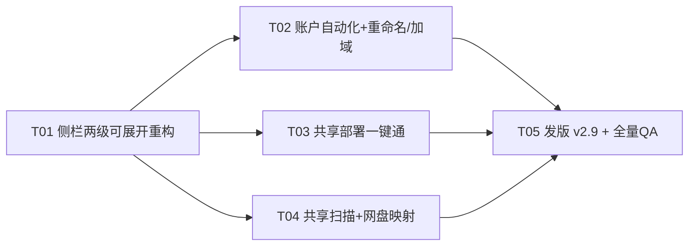

# NetAdmin Toolbox v2.9 增量技术设计与开发计划

> 作者：架构师 高见远（Gao）· 2025-10
> 状态：供用户 review 后执行 ｜ 基线：v2.8（51 模块 / 12 分组，已发版）
> 方法：全部结论基于源码逐行勘察（文件+行号）+ 本机只读实测，未改动任何代码。
>
> ⚠️ 勘察环境说明：本会话沙箱将 `reg.exe`、`sc.exe` 列入程序黑名单（尝试执行返回
> "PROGRAM BLOCKED BY SECURITY POLICY"），注册表/服务逐项实测被阻断，按规则不做等价绕过。
> 文中涉注册表项均标注「沙箱不可测」，QA 批次须用文内给出的只读命令在测试机补测。
> `dist/netadmin-toolbox.exe --list`（只读）执行成功，分组顺序实证见 1.1.3。

---

## 结论速览（给赶时间的读者）

| 需求 | 结论 | 关键发现 |
|---|---|---|
| R5 侧栏重构 | **选路线 (a)：保留 ListBox 升级为两级可展开** | 「序号乱」根因是分组顺序 = 翻译单元链接顺序（module.cpp:27-38 按 Register 先后建组），实测 `--list` 中「系统管理」排在「系统信息」之前；侧栏本无数字编号，重构=固定顺序表+展开态+字号提升，改动面收敛在 BuildNav/DrawNavItem/OnCommand 三处 |
| R1 账户+自动登录 | 新模块 `sys.acct`，NetUserAdd level 1 | 空密码账户网络登录受 LSA `LimitBlankPasswordUse`（默认=1）限制，但**交互登录与 autologon 不受限**；自动登录走 Winlogon 四键，明文密码必须风险提示 |
| R2 重命名/加域 | 新模块 `sys.domain`，SetComputerNameExW + NetJoinDomain | 用 `ComputerNamePhysicalDnsHostname`（NetBIOS 名自动派生，≤15 字符）；加域/退域均需重启，UI 必须讲清配置文件加载风险 |
| R3 共享部署 | 新模块 `net.sharehost`，一键体检 + 分项开关 | 权威清单共 14 项（6 服务 + 2 防火墙规则组 + 网络配置文件 + Guest 登录 + 4 个「不建议改」项），复用 v2.8 Actions/ActionWarning 范式（secmods.cpp:531-560 实证） |
| R4 扫描映射 | 新模块 `net.sharemap`，单模块承载扫描+映射 | 并发/超时复用 net.lanscan 线程池范式（netmods.cpp:1467-1496，48 线程+stop 标志）；前置 445 端口 300ms 非阻塞探测（net.portscan 范式 netmods.cpp:1326-1391）再 NetShareEnum，杜绝离线主机拖死扫描 |

---

# 一、现状勘察报告

## 1.1 侧栏实现现状（R5，本次 UI 重构对象）

### 1.1.1 数据结构与构建

| 实证 | 位置 | 说明 |
|---|---|---|
| 侧栏条目模型 | appwindow.cpp:64-68 | `struct NavEntry { bool isGroup; wstring text; int moduleIndex; }` —— **扁平列表 + isGroup 标记**，无层级/展开态字段 |
| 构建函数 | appwindow.cpp:722-774 `BuildNav()` | 取 `ModuleRegistry::Grouped()`（module.cpp:27-38）→ 逐组先压入组头行、再压入模块行（:745-746）→ `LB_RESETCONTENT` + 逐条 `LB_ADDSTRING`（:749-751）→ 每条 `LB_SETITEMHEIGHT`（组矮项高，:754-756） |
| 组头文案 | appwindow.cpp:744 | `g.group + L" · " + 数量`，如「常用管理 · 6」——**组头自带条数，不是编号** |
| 分组顺序来源 | module.cpp:27-38 `Grouped()` | 按模块 **Register 先后**建组；Register 顺序 = 静态初始化跨翻译单元顺序 = **链接顺序**，开发者完全不可控 |
| 侧栏控件 | appwindow.cpp:481-484 | `WC_LISTBOXW`，样式 `LBS_NOTIFY \| LBS_OWNERDRAWVARIABLE \| LBS_HASSTRINGS \| LBS_NOINTEGRALHEIGHT` —— **可变行高已启用**，是路线 (a) 的关键前提 |
| 子类化（悬停+滚轮） | appwindow.cpp:296-333 `NavHoverProc` | WM_MOUSEMOVE→`LB_ITEMFROMPOINT` 命中检测（:301-307，跳过组头 :787）；WM_MOUSEWHEEL 手动 `LB_SETTOPINDEX` 每格滚 2 行（:319-331） |
| 点击切换 | appwindow.cpp:1808-1827 `OnCommand` | 真实点击走 **`WM_COMMAND(ID_NAV, LBN_SELCHANGE)`** → `LB_GETCURSEL` → 组头行为「跳到组内第一项」（:1811-1820），模块行为 `cur_` 赋值 + `ApplyModuleToUi()`（:1822-1825） |
| 搜索过滤 | appwindow.cpp:1828-1841 | `ID_SEARCH EN_CHANGE` → `filter_` → **整表重建 `BuildNav()`**；匹配字段 = Title/Description/Id（:729-732，ContainsCI 不区分大小写）；无匹配显示 `noMatch_` STATIC（:773） |
| 行高与缩放 | appwindow.cpp:610-614 | Ctrl+= 缩放（ChangeScale :630-676）→ `ApplyFontsToChildren()` → 重发 `LB_SETITEMHEIGHT`（`size::NavGroup=36` / `size::NavItem=46`，design.h:316-317，全部走 dpi::S） |
| 绘制 | appwindow.cpp:1598-1639 `DrawNavItem` | 组头行用 `SmallStrong`(14px) 灰字（:1607-1611）；模块行 = 图标（PickIcon :81-152）+ `Body`(17px) 文字 + 选中/悬停圆角胶囊（:1616-1624，带 selAnim_ 动画 :2030-2036） |
| 滚动指示 | appwindow.cpp:1483-1500 | 侧栏隐藏系统滚动条，自绘 3px 细滑块（按 LB_GETTOPINDEX 折算偏移） |
| 列表底色 | appwindow.cpp:2001-2006 | `WM_CTLCOLORLISTBOX` 返回 bSide_，跟随主题 |

### 1.1.2 「序号乱、字号小」的实证根因

1. **序号乱 = 分组顺序乱（非数字编号问题）**。侧栏与 `--list` 均无全局数字编号（逐条核对 BuildNav 与 cli.cpp 输出，模块标题不含数字前缀）。实测 `--list` 的分组顺序：
   `系统管理 → 系统信息 → 系统维护 → 软件管家 → 安全体检 → 网络管理 → 网络诊断 → 常用管理 → 磁盘清理 → 空间分析 → 高级工具 → 系统优化`
   ——「系统管理」因 taskmods.cpp 等的链接顺序排到了最前，「常用管理」被挤到第 8 位，高频的「磁盘清理」排第 9。对 51 模块的工具而言，这是把高频功能埋到折叠区以下的体验缺陷。
2. **字号小 = 组头用了 SmallStrong(14px) + TextFaint**（appwindow.cpp:1611），在 46px 高的行里视觉权重低于模块行的 17px 正文，扫视时组头反而"消失"。模块行 17px 本身不算小，但组头小字 + 无展开交互，让 12 组 51 项的扁平长列表缺乏导航骨架。

### 1.1.3 重构选型：路线 (a) vs 路线 (b)

| 维度 | (a) 保留 ListBox，行内容自绘两级+展开态 | (b) 换自绘 owner-draw 面板（参照 LogView 范式） |
|---|---|---|
| 改动面 | BuildNav（加展开过滤）+ DrawNavItem（组头加 chevron）+ OnCommand 组头点击改「切换展开」+ 持久化读写，约 4 处、预估 ≤250 行 | 新建控件类（悬停/滚轮/键盘/焦点/命中/滚动条全部自理，参照 LogView 746 行规模），并重接 WM_CTLCOLOR/焦点环/无障碍 |
| 键盘无障碍 | 免费获得：方向键、Tab、LB_SETCURSEL 同步滚动 | 需手工实现全套（WM_GETDLGCODE、Home/End、字符导航…），漏一项就是回归 |
| Ctrl+= 缩放 | LB_SETITEMHEIGHT 机制现成（:610-614 照抄） | 行高全手工，需重算 |
| 51 模块/12 组规模 | VARIABLE 行高 + 重建 = O(n) 毫秒级，无压力 | 同样无压力 |
| 深浅主题 | WM_CTLCOLORLISTBOX + DrawNavItem 已全部走令牌 | 同样要走令牌，无优势 |
| 可变行高折叠 | LBS_OWNERDRAWVARIABLE 支持每条不同高度（已启用），展开/收起=重建字符串表 | 任意 |

**选型：路线 (a)。** 决定性理由：现有侧栏已经把"自绘行内容"做完了（DrawNavItem 全行手绘），ListBox 只承担"命中测试/键盘/滚轮/滚动量"四件机械事——这正是它擅长的；(b) 要重写这四件事，收益为零、回归面覆盖全部 51 个模块的入口。ThemePickerDialog 的卡片范式适用于"自由布局内容页"，不适用于"长列表导航"。

**侧栏重构对 51 模块零影响的保证**：侧栏只消费 `IModule::Id/Group/Title/Description`（BuildNav :726-747），不调用任何模块方法；重构保持 NavEntry 数据流（navs_ ↔ mods_ ↔ cur_）与 `ApplyModuleToUi()` 入口不变，模块文件一行不改。

### 1.1.4 新分组排序与编号规则（设计）

- **一级分组展示顺序 = 固定顺序表**（appwindow.cpp 内 `kGroupOrder[]`，按 Group() 字符串匹配排序，未登记的组垫底），不再依赖链接顺序：
  `磁盘清理 → 空间分析 → 网络运维（=网络管理+网络诊断相邻）→ 系统管理 → 系统信息 → 常用管理 → 软件管家 → 安全体检 → 高级工具 → 系统优化 → 系统维护`
  说明：任务建议的「清理瘦身/网络运维/系统管理/软件管家/安全体检/常用工具」分区思路采纳为**排序原则**（高频清理放最上、网络次之、低频优化垫底），但**不改模块 Group() 字符串**（改字符串会破坏 CLI `--list` 输出与 v2.8 文档一致性），仅在侧栏做展示层排序；「网络管理/网络诊断」相邻展示即可达成"网络运维"分区语义。
- **编号规则：不引入数字编号**（现状本无编号；数字会随模块增减漂移，51→55 后必乱）。一级组保留「组名 · 条数」格式 + 新增 chevron 展开箭头；二级模块保持 图标+文字。
- **字号提升**：组头 `SmallStrong(14px)` → `Body(17px 半粗)`，行高 `NavGroup 36 → 44`；模块行 `NavItem 46 → 42`（二级视觉从属，总高度反而更省：收起时 12 组仅占 12×44=528px，比现在 12 组头+51 项=1248px 小一半）。

## 1.2 账户与域（R1/R2 勘察）

### 1.2.1 sys.users 现状（可复用资产）

| 实证 | 位置 | 说明 |
|---|---|---|
| 模块定义 | mgmtmods.cpp:353-522 `SysUsersModule` | Tweaks 型，NeedsElevation=true（:360） |
| 枚举 | mgmtmods.cpp:371 | `NetUserEnum(nullptr, 3, FILTER_NORMAL_ACCOUNT, …)`，USER_INFO_3 全字段 |
| 启/禁用 | mgmtmods.cpp:454-459 | `NetUserSetInfo(nullptr, name, 1008, &ui, …)` 只动 UF_ACCOUNTDISABLE 位，其余属性保留 |
| 内置账户保护 | mgmtmods.cpp:347-351 | Administrator/Guest/DefaultAccount 拒绝操作；ActionWarning 动态列名（:405-424） |
| tag 映射 | mgmtmods.cpp:484-486 | `names_[tag]`/`flags_[tag]` 私有数组，排序后仍可回溯（module.h:43 设计） |

**R1 增量点（新建账户，不走 sys.users 改造，避免污染现有启/禁用语义）**：

- **创建**：`NetUserAdd(nullptr, 1, (LPBYTE)&ui1, &parmErr)`。字段：
  `usri1_name`（≤20 字符）、`usri1_password`（可空）、
  `usri1_priv = USER_PRIV_USER`（**必须显式给**，否则 NERR_InvalidPriv）、
  `usri1_flags = UF_PASSWD_NOTREQD | UF_DONT_EXPIRE_PASSWD`（空密码场景必须带 UF_PASSWD_NOTREQD，否则 NERR_PasswordTooShort 类拒绝）、`usri1_home_dir/script_path = NULL`。
  改密用 level 1003（`usri1003_password`）。lm.h/lm.lib（libnetapi32.a）v2.8 已链接（build.bat `-lnetapi32`，sys.users 实证可用）。
- **空密码与策略的关系（权威）**：策略「账户：限制本地账户使用空密码（仅限控制台登录）」=
  `HKLM\SYSTEM\CurrentControlSet\Control\Lsa : LimitBlankPasswordUse`（默认 1）。
  影响范围**仅网络登录**（共享访问/远程 RPC 用空密码账户会被拒）——交互式登录、自动登录（autologon 走 LSA 的 LsaLogonUser 本地路径）**不受该值限制**。沙箱不可测本机值，QA 用
  `reg query "HKLM\SYSTEM\CurrentControlSet\Control\Lsa" /v LimitBlankPasswordUse` 补测。
  产品决策：**不自动改 LimitBlankPasswordUse**（安全基线），仅在结果 hint 里说明"空密码账户不能用于共享访问，如需共享请设置密码"。
- **自动登录（Winlogon）清单**：`HKLM\SOFTWARE\Microsoft\Windows NT\CurrentVersion\Winlogon` 下
  `AutoAdminLogon="1"`、`DefaultUserName`、`DefaultPassword`（**明文**）、`DefaultDomainName`（本机账户填计算机名或留空）。
  风险与缓解：明文落盘任何人可读 → ① 确认框红色危险态列明风险 ② hint 建议优先用 Sysinternals Autologon（把密码加密进 LSA secret，不在注册表留明文，我们不重复造轮子，见不做清单）③「关闭自动登录」动作一键清四键（DefaultPassword/AutoAdminLogon 删除，DefaultUserName 保留）。沙箱不可测，QA 补测 `reg query "…\Winlogon" /v AutoAdminLogon`。

### 1.2.2 重命名与加域/工作组（R2）

- **重命名**：`SetComputerNameExW(ComputerNamePhysicalDnsHostname, name)` —— 选 **DNS 主机名**而非 NetBIOS（`ComputerNamePhysicalNetBIOS`）：DNS 名允许 ≤63 字符且系统自动截派 ≤15 的 NetBIOS 名，反向则要手工算 NetBIOS 名；名字合法性自校验（仅字母数字连字符、不以连字符结尾）后生效需重启。错误码中文映射复用 sysmods.cpp:75-91 的 `Win32Err` 思路。
- **加域**：`NetJoinDomain(nullptr, domain, ou(可空), user, pass,
  NETSETUP_JOIN_DOMAIN | NETSETUP_ACCT_CREATE)`；可选 `NETSETUP_DOMAIN_JOIN_IF_JOINED`（已加域时先退再进，默认不启用，UI 拦截）。OU 参数仅域管可控时有效。
- **退域/改工作组**：加工作组 = `NetJoinDomain(nullptr, L"WORKGROUP", …, fJoinOptions=0)`；退域 = `NetUnjoinDomain(nullptr, user, pass, NETSETUP_ACCT_DELETE)`（可选删域侧计算机账户）。
- **共同点**：全部**重启后生效**（`ComputerNamePhysicalDnsHostname` 变更以 WaitForSingleObject 等待 `GetComputerNameEx` 回读确认，完成后提示重启）。
- **危险面（进确认框 danger 文案）**：① 域环境改计算机名/退域 → 本机配置文件（域 profile）无法再加载，用户桌面/文档看似"丢文件"（实为切到本地 profile）② 输错域名/无凭据重试会积累坏计算机账户 ③ 退域前必须确保本地管理员密码已知，否则可能锁死在域外无法登录。`wmic computersystem get domain`（QA 补测）可读当前域/工作组状态；程序内用 `GetComputerNameExW(ComputerNameDnsDomain)` 读。

## 1.3 共享部署权威清单（R3，逐项勘察）

> 读取方法全部为只读；「开启/关闭」即新模块分项开关的动作实现。风险等级：🟢 安全 / 🟡 需确认 / 🔴 高危（默认不动）。

| # | 项 | 读取方法 | 开启方法 | 关闭方法 | 风险 | 备注 |
|---|---|---|---|---|---|---|
| 1 | Server 服务 LanmanServer | `sc qc/query LanmanServer` | `ChangeServiceConfigW`→Automatic+StartService | 仅停用不禁用（禁用=🔴 断共享能力） | 🟡 | 供别人访问我；sys.services 已有 9 动作能力可复用（sysmods.cpp:1003-1004） |
| 2 | Workstation 服务 LanmanWorkstation | `sc qc/query` | 同上（默认已开） | 🔴 不做 | 🟢 | 访问别人的共享，默认开 |
| 3 | FDResPub / SSDPSRV / upnphost / fdPHost | `sc qc` ×4 | 自动(延迟)→启动 | 手动→停止 | 🟡 | 网络发现四件套；FDResPub 让本机出现在"网络"里 |
| 4 | 防火墙「文件和打印机共享」规则组 | `netsh advfirewall firewall show rule group="文件和打印机共享"`（英文系统用 `group="File and Printer Sharing"`） | `netsh advfirewall firewall set rule group="<本地化组名>" new enable=Yes` | enable=No | 🟡 | **组名随系统语言本地化**，代码里按两种语言探测，探测不到则枚举规则按 `FirewallPolicy\FirewallRules` 的 Grouping 字段匹配（备选，仅读） |
| 5 | 防火墙「网络发现」规则组 | 同上（`group="网络发现"` / `"Network Discovery"`） | 同上（需先启动 #3 四服务，规则组内含 svchost 依赖） | enable=No | 🟡 | 只开规则不启动服务 = 假开启，体检项要合并判定 |
| 6 | 当前网络配置文件 Public/Private | `INetworkListManager::GetCategory`（COM，netprofm 服务）或 `Get-NetConnectionProfile` | COM `SetCategory(NLM_CATEGORY_PRIVATE)` | 同路径设回 Public | 🟡 | Public 下共享/发现规则组整组不生效；改前确认框讲清"家庭/办公网才建议 Private" |
| 7 | 不安全来宾登录 AllowInsecureGuestAuth | `reg query HKLM\SYSTEM\CurrentControlSet\Services\LanmanWorkstation\Parameters /v AllowInsecureGuestAuth` | `RegSetKeyValue` DWORD=1 | 删除值或=0 | 🟡 | Win10 1709+ 默认 0；=1 才能匿名访问 NAS/老设备的共享（SMB2 客户端侧）。**这是 R3 场景里最常缺的一键** |
| 8 | 密码保护共享（匿名枚举） | `reg query HKLM\SYSTEM\CurrentControlSet\Control\Lsa /v EveryoneIncludesAnonymous` | =1（即"关闭密码保护共享"效果） | =0 | 🟡 | 配合 #1 让无账户设备也能访问；确认框提示暴露面 |
| 9 | RestrictAnonymous（Server 侧） | `reg query …\LanmanServer\Parameters /v RestrictAnonymous` | **不自动改** | — | 🔴 | 改 0 会放宽匿名枚举，安全面大；体检只读展示，提示手动决策 |
| 10 | RestrictNullSessAccess / NullSessionShares | `reg query …\LanmanServer\Parameters` | **不自动改** | — | 🔴 | 仅特殊遗留设备需要；列为「不建议改」 |
| 11 | SMB 签名 RequireSecuritySignature（客户端/服务端） | `reg query …\LanmanWorkstation\Parameters`（服务端同名在 LanmanServer） | **不自动改** | — | 🔴 | 降签名有中间人风险；且 Win11 24H2 起默认强制签名，关闭会连不上新设备 |
| 12 | 组策略 HardenedPaths | `reg query HKLM\SOFTWARE\Policies\Microsoft\Windows\NetworkProvider\HardenedPaths` | **不自动改** | — | 🔴 | 这是"加固"项（限制 UNC 走 MSAUTH），与"开通共享"方向相反，列出仅作体检信息 |
| 13 | 组策略 LanmanWorkstation\Policies 系位 | 同上只读 | **不自动改** | — | 🔴 | 域环境 GPO 覆盖位，改了会被域策略刷回；体检展示 |
| 14 | SMB1（minisrv/client 可选组件） | `Get-WindowsOptionalFeature -Online -FeatureName SMB1Protocol` | **不做**（见不做清单） | — | 🔴 | WannaCry 级历史漏洞面；默认列表里只显示状态不提供开关 |

**落地形态**：`net.sharehost`（网络管理组）——`Run()` = 一键体检，14 项逐行输出（c1=项名，c2=正常/异常，c3=类别，c4=建议），全绿则 summary「本机共享环境已就绪」；`Actions()` =
①「一键开通全部共享设置」（对 🟡 项批量执行，逐项日志，🔴 项永不触碰）
②「一键恢复保守设置」（反向关 #3-#8，恢复默认）
③「更多 ▾」= 分项开关（停用 Server / 关闭来宾登录 / 切换网络配置文件…）。
确认框范式照抄 secmods.cpp:531-560 的 `Actions()+warning` 与 mgmtmods.cpp:405-424 的 `ActionWarning` 动态文案；提权检查照抄 secmods.cpp:581-589（非管理员拒绝写操作）。

## 1.4 共享扫描与映射（R4 勘察与选型）

### 1.4.1 主机发现选型

| 路线 | 优 | 劣 | 结论 |
|---|---|---|---|
| A：`NetServerEnum(SV_TYPE_SERVER)` 一步拿主机名+备注 | 无 ping、最省流量 | 依赖 Computer Browser/主浏览器，现代家庭网（无域、AP 隔离、IPv6-only NAS）经常返回空/半空 | **辅助**：作为"快速发现"首选项，返回空自动降级 B |
| B：网段 Ping 扫描（复用 net.lanscan 范式）+ 存活主机逐台验 445 | 与现有代码同构、可控超时/取消 | 多一轮扫描 | **主路径** |

并发/超时设计（全部有代码范式）：
1. **Ping 扫描**：48 线程池 + `stop` 原子标志 + 120ms 轮询进度（照抄 netmods.cpp:1467-1496 `SweepState`/`SweepWorker`）。
2. **445 端口预探测**：非阻塞 connect + `select` 300ms 批量 24 路（照抄 netmods.cpp:1326-1391 端口扫描批次）——`NetShareEnum` 本身**无超时参数**，离线主机会阻塞 2~5s，先探测 445 再枚举共享是防"单台离线机拖死全局"的关键设计。
3. **共享枚举**：仅对 445 开放的主机 `NetShareEnum(server, 1, …)`（SHARE_INFO_1 够用：netname/type/remark；秒级）；`Error 5/NERR_AccessDenied` 常见（对端要求凭据），标记「需凭据」行，不中断整体。
4. 管理共享过滤直接复用 mgmtmods.cpp:527-532 `IsManagementShare`（IPC$/ADMIN$/X$），映射列表默认隐藏、按勾选为准。

### 1.4.2 映射与管理

| 能力 | API | 设计 |
|---|---|---|
| 映射 | `WNetAddConnection2W(NETRESOURCE{dwType=RESOURCETYPE_DISK, lpRemoteName=\\\\host\\share, lpLocalName=所选盘符}, 密码/用户, 0)` | 盘符选择器：`GetLogicalDrives()` 位图取未占用字母（Z 往前），冲突时 UI 列表选；`dwFlags=CONNECT_UPDATE_PROFILE`（登录时自动重连=持久） |
| 凭据 | lpUserName/lpPassword 参数 | 空则用当前凭据；失败 `ERROR_LOGON_FAILURE(1326)` → hint 提示在目标框格式 `user:pass`（不落盘、不缓存，**不实现凭据管理器写入**） |
| 已映射列表 | `WNetOpenEnum(RESOURCE_CONNECTED, RESOURCETYPE_DISK,…)` + `WNetEnumResource` | 本地名/远程名两列；亦可用 `WNetGetConnectionW(盘符)` 反查 |
| 断开 | `WNetCancelConnection2W(本地名或远程名, 0, fForce)` | fForce=有打开文件时强制断（danger 确认） |

### 1.4.3 模块划分

**单模块 `net.sharemap`**（不建议拆两个）：扫描是映射的前置状态，拆开要跨模块传"上次的扫描结果"（模块实例各自持有状态，ModuleRegistry 无模块间通信），单模块 Run=扫描、Actions=映射/断开即可覆盖全流程，也与 sys.shares/sys.users 的既有交互模式一致。

---

# 二、增量设计

## 2.1 新模块清单表（v2.9 目标 +4 模块，总 55）

| Id | Group | Title | Kind | 动作语义（Actions[]） | 数据来源 API | NeedsElevation | 风险 |
|---|---|---|---|---|---|---|---|
| `sys.acct` | 系统管理 | 账户部署 | Action | ①「创建/更新账户」（目标框=用户名，路径框=描述可选；密码留空→空密码+UF_PASSWD_NOTREQD）②「配置自动登录」③更多：「关闭自动登录」「删除指定账户」（NetUserDel，danger） | NetUserAdd(1)/NetUserSetInfo(1003)/NetUserDel；Winlogon 注册表 | 是 | 高（明文密码/新账户暴露面） |
| `sys.domain` | 系统管理 | 计算机名与域 | Action | ①「重命名计算机」（目标框=新名称）②「加入域」（目标框=域名，路径框=OU 可选；凭据走目标框 `user:pass`）③更多：「退域回工作组」「查看当前状态」 | SetComputerNameExW / NetJoinDomain / NetUnjoinDomain / GetComputerNameExW | 是 | 高（重启生效/退域锁死风险） |
| `net.sharehost` | 网络管理 | 共享部署 | Action（体检+开关） | ①「一键开通共享环境」②「恢复保守设置」③更多：分项开关（1.3 清单 🟡 项） | SCM/注册表/netsh(子进程，procrun 通道)/INetworkListManager | 是 | 中 |
| `net.sharemap` | 网络管理 | 共享扫描与网盘映射 | Tweaks(动作) | ①「映射选中为网盘」（盘符=目标框可空自动分配）②「断开选中连接」③更多：「重新扫描」「打开共享文件夹(ShellExecute)」「断开全部网盘(danger)」 | NetServerEnum/NetShareEnum(1)/WNetAddConnection2/WNetEnumResource/WNetCancelConnection2 | 否（映射当前用户凭据即可；扫描不需） | 低-中 |

框架扩展点：
- **无新增控件类**（侧栏选路线 a）；module.h **零改动**（4 个新模块全部落在 v2.8 已有的 Actions/RunAction/ActionWarning/RefreshAfterAction 能力内，逐一对得上 secmods/mgmtmods 现成范式）。
- **展开状态存储**：design.cpp 的 ini 持久化通道（SaveUserScale 同文件同机制）新增键 `NavExpanded=<组名1,组名2,…>`；默认全展开（v2.8 用户无学习成本），折叠是增量能力。BuildNav 按展开集合过滤二级条目。
- **搜索框交互**：过滤期间强制全展开（忽略折叠态），清空搜索恢复记忆的展开态——防止"搜到了但组是折的"的困惑。
- 新模块图标补入 appwindow.cpp PickIcon kMap（:86-130 追加 4 条）。

## 2.2 版本与文案

common.h:41-42 `k_AppVersionMinor` 8→9；app.rc 版本资源同步；README 模块数 51→55 与新增章节。

---

# 三、开发计划

## 3.1 分批任务表（5 批次，与任务系统 T01-T05 对应）

**T01 侧栏两级可展开导航重构**（P0，先行——影响所有页面的入口体验）

- 涉及文件：`src/ui/appwindow.cpp`（BuildNav/DrawNavItem/OnCommand/NavHoverProc/LB_SETITEMHEIGHT/持久化）、`src/ui/design.h`（size::NavGroup 44/NavItem 42 令牌、组头字体）、`src/ui/design.cpp`（ini 增 NavExpanded 键读写）、`src/module.cpp`（Grouped() 无改，仅注释说明顺序由 UI 层控制）
- 依赖：无（起点）
- 验收：①分组按 1.1.4 固定顺序展示，与 `--list` 顺序脱钩 ②点击组头=展开/收起，chevron 方向正确，展开态重启后保持 ③搜索时强制展开、清空恢复 ④51 模块逐个点开无一失准（cur_ 映射正确）⑤Ctrl+= 缩放后行高/字号同步 ⑥四主题下组头/选中/悬停配色正确 ⑦键盘上下键+回车切模块、滚轮正常 ⑧收起状态 12 组全部可见（不滚动）
- 回归：gui_smoketest.ps1 + 全 55 模块冒烟

**T02 本地账户自动化 + 计算机重命名/加域**（P0）

- 涉及文件：新增 `src/modules/acctmods.cpp`（sys.acct + sys.domain 两模块）、`build.bat`（源清单自动收集，确认新文件被收编）
- 依赖：T01（新模块要能被新侧栏找到；功能本身只依赖 v2.8 框架）
- 验收（QA 虚拟机/快照环境执行）：①创建空密码账户成功且 `net user <名>` 验证 UF_PASSWD_NOTREQD ②配自动登录后 Winlogon 四键正确、重启免密进入 ③关闭自动登录四键清理干净 ④重命名后 `GetComputerNameExW` 回读一致、重启生效 ⑤加域/退域在测试域环境走通，退域后本地 profile 警告文案完整 ⑥全部动作确认框 danger 态正常
- 风险对冲：所有写操作前检查 `IsElevated()`（secmods.cpp:581-589 范式）；重启提示不代重启（不主动 ExitWindowsEx）

**T03 共享部署一键通**（P1）

- 涉及文件：新增 `src/modules/sharehost.cpp`（net.sharehost）、复用 `src/procrun.cpp`（netsh 通道）
- 依赖：T01（同 T02 理由）；与 T02 无耦合
- 验收：①体检 14 项逐项有结论，与手工 `sc qc`/`reg query`/`netsh show` 三方对账一致 ②一键开通后：同网段另一台机器可见本机共享并能枚举 ③恢复保守设置后逐项回到默认 ④🔴 项（RestrictAnonymous/SMB 签名/HardenedPaths/SMB1）全程只读展示无开关 ⑤英文系统（组名本地化探测）不崩溃
- 回归：`net share`、`\\127.0.0.1` 自访、对端机实测

**T04 共享扫描 + 一键映射网盘**（P1）

- 涉及文件：新增 `src/modules/sharemap.cpp`（net.sharemap）
- 依赖：T01；功能上与 T03 互补（对端未开通时提示"用共享部署"），无代码耦合
- 验收：①对含 1 台离线 IP 的 /24 网段扫描 ≤15s（445 预探测生效）②映射→资源管理器可见盘符→断开后消失 ③CONNECT_UPDATE_PROFILE 后注销重登自动重连 ④「断开全部」有 danger 确认 ⑤对端要求凭据时显示「需凭据」行而不是卡死 ⑥管理共享（IPC$/C$）不出现在默认映射列表
- 回归：与 net.lanscan 结果交叉比对存活主机数

**T05 发版 v2.9 + 最终 QA 全量回归**（P0）

- 涉及文件：`src/common.h`（版本 2.9）、`src/app.rc`、`README.md`、`快速开始.txt`（如含模块数）、screenshots 更新
- 依赖：T01-T04 全部完成
- 验收：①`build.bat clean` 全量构建零警告 ②`--list` 55 模块、无重复 ③CLI `run` 新四模块输出与 GUI 一致 ④gui_smoketest.ps1 全绿 ⑤沙箱阻断的注册表/服务实测项（1.2/1.3 清单标注处）在 QA 机补测归档 ⑥截图更新
- 回归方法（每批统一）：`cmd /c build.bat` → `--list` 模块数比对 → 新模块 `run` 冒烟 → gui_smoketest.ps1 → 针对性验证。破坏性动作（加退域/重命名/自动登录）一律先在快照虚拟机执行。

## 3.2 风险登记册

| # | 风险 | 等级 | 缓解 |
|---|---|---|---|
| 1 | 误加错域/输入错凭据反复尝试锁死计算机账户 | 高 | 加域前 `GetComputerNameExW(DnsDomain)` 判定已加域则拦截；连续失败 2 次即停并给出手工指引；不做"自动重试" |
| 2 | 自动登录明文密码落盘 | 高 | danger 确认框列明风险 + hint 推荐 Sysinternals Autologon；「关闭自动登录」一键清除；日志不回显密码 |
| 3 | 组策略/共享相关键改坏（RestrictAnonymous 类） | 高 | 1.3 清单把 🔴 项硬编码为只读展示；🟡 项逐项开关+逐项日志；「恢复保守设置」提供回退路径 |
| 4 | SMB 相关服务误停（LanmanServer 禁用后共享面瘫） | 中 | 只停用不禁用；动作后 RefreshAfterAction 重扫展示真实状态；体检项把"被禁用"标异常 |
| 5 | 侧栏重构回归风险（51 模块入口错乱） | 中 | NavEntry→mods_ 映射数据流不变；T01 验收含 55 模块逐个点开；搜索/缩放/主题三专项 |
| 6 | NetShareEnum 无超时，离线主机拖死扫描 | 中 | 445 端口 300ms 预探测前置；线程池 stop 标志 + Esc 取消 |
| 7 | 防火墙规则组名本地化（英文系统探测失败） | 中 | 中英双组名探测 + 按规则 Grouping 字段兜底匹配；失败给中文指引不崩溃 |
| 8 | 沙箱/QA 环境差异（注册表默认值未实测） | 中 | 文内所有 `reg query` 命令在 QA 机补测归档后再定终值 |

## 3.3 不做清单（Out of Scope）

- SMB1 启用（安全红线；只读显示状态）
- 自动登录密码加密存储（不重复实现 Sysinternals Autologon 的 LSA secret 方案，文档指引即可）
- 域加入后的移动 profile / 组策略结果集（gpresult/rsop）管理
- AD 站点/OU 浏览器级操作（OU 仅作可选字符串透传）
- 凭据管理器写入（Credential Manager API 存储 SMB 凭据）——凭据仅会话内使用
- LimitBlankPasswordUse / RestrictAnonymous / SMB 签名 / HardenedPaths 的自动修改
- 修改模块 Group() 字符串（保持 CLI `--list` 与 v2.8 文档一致性，分区仅侧栏展示层）

## 3.4 任务依赖图

---

## 附：勘察证据清单

| 证据 | 来源 |
|---|---|
| 侧栏数据结构/构建/绘制/点击/过滤/滚轮/缩放 | appwindow.cpp:64-68, 296-333, 481-484, 610-614, 722-774, 1454-1501, 1598-1639, 1808-1841, 2001-2006（逐行核对） |
| 分组顺序=注册（链接）顺序 | module.cpp:27-38 + 实测 `dist/netadmin-toolbox.exe --list` 输出（12 组顺序全文见 1.1.2） |
| 尺寸/字体令牌 | design.h:294-328（font/size 命名空间） |
| sys.users 启/禁用与保护 | mgmtmods.cpp:347-351, 353-522 |
| sys.shares 管理共享判定 | mgmtmods.cpp:524-680（IsManagementShare :527-532） |
| Actions/ActionWarning 范式 | secmods.cpp:531-613, mgmtmods.cpp:396-475 |
| 提权拒绝范式 | secmods.cpp:581-589 |
| 端口扫描并发/超时范式 | netmods.cpp:1291-1412（24 路 select+300ms） |
| 局域网扫描线程池范式 | netmods.cpp:1435-1564（48 线程+stop+120ms 轮询） |
| 版本常量 | common.h:41-42 |
| 沙箱阻断 | reg.exe / sc.exe 执行被 Security Center 程序黑名单拦截（错误见 1.2.1/1.3 标注），按规不做等价绕过；涉本机实测项待 QA 补测 |
